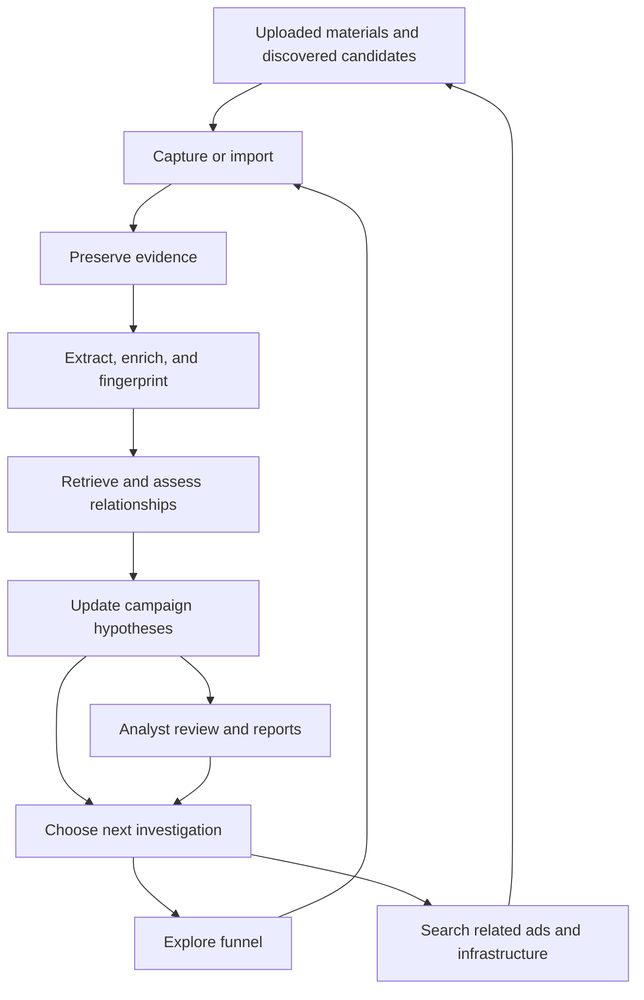

**I recommend an architecture built around a persistent evidence store, a typed relationship graph, and two investigation loops: following the funnel deeper and searching outward for related campaigns.** Deterministic processing handles repeatable analysis; bounded agents decide where additional investigation is worthwhile.

This supports both the NASK demonstrator and a later system that continuously discovers new ads, domains, funnels, and campaign variants. The design below is my synthesis of published research and documented platform capabilities.

**The architectural patterns worth combining**

| Pattern | What it contributes | Where it falls short alone |
|---|---|---|
| **Processing pipeline / DAG** | Repeatable capture, extraction, enrichment, and indexing. Easy to test and replay. | Cannot anticipate every redirect, quiz, login, or messaging handoff. |
| **Adaptive investigation supervisor** | Chooses the next tool or investigative lead based on accumulated evidence. | Needs explicit budgets, persistent state, and constrained actions. |
| **Shared evidence store** | Specialists contribute findings without passing an ever-growing conversation between themselves. | Requires consistent schemas and provenance. |
| **Typed, temporal knowledge graph** | Represents infrastructure, advertisements, funnel steps, and campaign hypotheses together. | Graph connectivity alone does not establish campaign membership. |
| **Multiple retrieval indexes with late fusion** | Finds candidates through text, visuals, identifiers, and infrastructure independently. | Retrieval scores need a separate relationship assessment. |
| **Prioritized discovery frontier** | Controls which new URLs, ads, and infrastructure leads get investigated next. | Needs deduplication, novelty checks, and stopping rules. |

There are close research precedents:

- **[EPhishCADE](https://arxiv.org/html/2502.20621v1)** combines enrichment, coarse structural grouping, and contextual graph analysis. It supports separating template similarity from broader campaign relationships. Its input assumes already identified phishing URLs, so it does not solve initial scam detection. [arxiv.org](https://arxiv.org/html/2502.20621v1?utm_source=chatgpt.com)
- **[PhishLumos](https://arxiv.org/html/2509.21772v1)** uses a supervisor and specialized investigators to pivot through URL, domain, IP, and certificate evidence when page content is unavailable. This is particularly relevant to cloaking and dead pages. [arxiv.org](https://arxiv.org/html/2509.21772v1?utm_source=chatgpt.com)
- **[Anansi](https://arxiv.org/html/2602.24223v1)** connects acquisition, scammer conversations, website interactions, and financial evidence collection. It demonstrates deeper funnel investigation, while explicitly retaining manual transitions in parts of its pipeline. [arxiv.org](https://arxiv.org/html/2602.24223v1?utm_source=chatgpt.com)
- **[MemoPhishAgent](https://arxiv.org/html/2602.21394v1)** explores multimodal tool use and retrieval of previous investigation episodes. This is useful for choosing efficient investigation steps; previous verdicts should remain distinguishable from newly observed evidence. [arxiv.org](https://arxiv.org/html/2602.21394v1?utm_source=chatgpt.com)

These papers provide architectural evidence, not a validated turnkey solution for the complete advertising problem.

**The recommended system has one processing backbone and two feedback loops.**

The distinction between the loops is essential:

| Loop | Question | Typical next step |
|---|---|---|
| **Funnel exploration** | What happens to someone who follows this advertisement? | Follow a CTA, inspect a quiz, observe registration, identify a messaging destination. |
| **Campaign discovery** | Where else is this operation or pattern appearing? | Search for another ad, matching resource, tracking ID, domain, advertiser, or narrative. |

Both loops produce additional inputs to the same analysis system. Neither should maintain a separate collection of facts.

**1. Preserve evidence before interpreting it.**

Treat a URL as an entity and a visit to it as an observation. One URL can produce different content at different times or in different sessions.

Each capture should preserve the available:

- Screenshot, rendered DOM, original HTML, and media.
- Requests, responses, redirect chain, and relevant resource bodies.
- Browser actions and their resulting states.
- Timestamp, entry URL, referrer, language, viewport, and session reference.
- Acquisition outcome: successful, partial, unavailable, blocked, authentication required, or inconclusive.

Use content hashes to deduplicate stored bytes, while retaining every observation and its context.

[Browsertrix](https://crawler.docs.browsertrix.com/) provides a useful reference for browser capture, configurable behaviors, and archival outputs. [Lookyloo](https://www.lookyloo.eu/docs/main/index.html) provides a reference for inspecting the domains and resources involved in a live page. [crawler.docs.browsertrix.com](https://crawler.docs.browsertrix.com/?utm_source=chatgpt.com)

**Architectural consequence:** extracting new features should normally operate on saved evidence. Revisiting the website is a new collection task, not an implicit part of reprocessing.

Archival replay may be incomplete for some dynamic or authenticated interactions; record capture completeness rather than assuming a saved page reproduces the whole experience.

**2. Use a data model that separates observations from conclusions.**

I would establish these objects before implementing individual analysis tools:

| Object | Purpose |
|---|---|
| `SourceRecord` | Original submission or discovery result, including provenance and usage restrictions. |
| `Artifact` | Immutable bytes: image, video, HTML, archive, transcript, or network log. |
| `Observation` | Something captured or returned by a provider at a particular time and context. |
| `Entity` | URL, domain, advertiser account, media asset, tracking identifier, contact, wallet, or organization. |
| `Feature` | An extracted value, its evidence location, extractor version, and quality information. |
| `Fingerprint` | A versioned representation used to recognize duplicates, templates, or operational patterns. |
| `RelationshipAssertion` | A typed connection supported or contradicted by identified evidence. |
| `CampaignHypothesis` | A revisable grouping with membership, rationale, uncertainty, and history. |
| `InvestigationTask` | Work to perform, with inputs, budget, status, and parent investigation. |
| `InvestigationSession` | Persistent browser or messaging state needed to continue an interaction. |

A relationship assertion should carry at least:

`subject`, `predicate`, `object`, `evidence_refs`, `method_version`, `observed_at`, `valid_time`, `assessment`, and `review_status`.

For example:

- Observation: two captures loaded the same script URL.
- Derived finding: their script bodies also have the same hash.
- Hypothesis: the pages may share a toolkit.
- Stronger hypothesis: other independent evidence suggests campaign membership.

This distinction follows the useful separation in STIX between observed data and intelligence assertions. OpenCTI demonstrates how entities and relationships can form a threat-intelligence knowledge graph; W3C PROV provides a model for recording derivation. [oasis-open.github.io](https://oasis-open.github.io/cti-documentation/examples/sighting-of-observed-data.html?utm_source=chatgpt.com)

Use STIX-compatible concepts and an export adapter. You do not need to force every browser state or image region directly into STIX.

**3. Extract several representations of each material.**

A single embedding loses distinctions that matter for investigation.

| View | Features and representations |
|---|---|
| **Text** | Native text, OCR, transcript, language, claims, narrative, product, CTA, named entities. |
| **Visual** | Exact and perceptual hashes, image embeddings, layout, logos, selected regions. |
| **Video/audio** | Scene-based keyframes, OCR over time, transcript segments, reused media. |
| **Page structure** | DOM structure, form fields, script/resource patterns, framework and template fingerprints. |
| **Infrastructure** | Domains, redirects, DNS history, certificates, hosting, analytics and pixel identifiers. |
| **Behavior** | Observed transitions, required inputs, handoffs, destinations, and terminal outcomes. |

Preserve references to the original text span, image region, video timestamp, DOM element, or request that produced a feature.

Two practical rules:

- **Keep original text alongside normalized or translated text.** Original strings can reveal reused wording, spelling mistakes, and operational identifiers.
- **Keep full URLs alongside comparison forms.** Removing query parameters may help similarity matching but can destroy affiliate IDs, campaign tokens, and redirect evidence.

Run independent extractors in parallel. A failed transcription should not prevent infrastructure analysis.

**4. Make enrichment a replaceable provider layer.**

Each enrichment adapter should return observations through the same contract:

| Required field | Why it matters |
|---|---|
| Subject and query | Makes the lookup reproducible. |
| Provider and retrieval time | Establishes provenance and freshness. |
| Provider observation time | Distinguishes historical evidence from current lookup time. |
| Raw response reference | Allows verification and reprocessing. |
| Parsed findings | Supports consistent downstream use. |
| Status and coverage | Distinguishes “not found” from “not accessible.” |
| Restrictions and cost | Supports controlled reuse and scheduling. |

Separate:

- Direct observations made by your browser.
- Historical observations returned by external services.
- Third-party reputation or maliciousness assessments.

A provider reporting no detection is not evidence that a page is benign. Likewise, several services repeating the same upstream report are not necessarily independent corroboration.

Cache enrichment according to the type of information. Historical records and current DNS answers have different refresh needs.

OpenCTI’s external-import and internal-enrichment connectors provide a useful precedent for keeping these integrations outside the core knowledge model. [OpenCTI Documentation](https://docs.opencti.io/latest/deployment/overview/?utm_source=chatgpt.com)

**5. Treat fingerprinting as a hierarchy.**

I would maintain four distinct fingerprint families:

| Fingerprint | Intended meaning |
|---|---|
| **Exact artifact** | These bytes are identical. |
| **Creative variant** | These images, videos, or texts are modified versions of one another. |
| **Template or toolkit** | These pages share structural or implementation patterns. |
| **Operational pattern** | These incidents share a combination of infrastructure, identifiers, destinations, and behavior. |

Do not collapse these into one “campaign fingerprint.”

Some fingerprints are individual values, such as a resource hash. Others are composite signatures, such as a distinctive combination of script paths, form structure, and tracking identifiers.

Every fingerprint needs a version and supporting evidence. A newly generated signature begins as a hypothesis until tested against additional cases and negative examples.

**6. Separate candidate retrieval from relationship decisions.**

Use a two-stage matching architecture.

**Stage A: retrieve plausible neighbors.**

Search independently through:

- Exact identifiers and resource hashes.
- Text and narrative similarity.
- Visual similarity.
- Page structure.
- Infrastructure relationships.
- Funnel destinations and observed behavior.

Take the union of candidates. Rank fusion can organize results without assuming that scores from different models are comparable.

Qdrant documents both separate named vector spaces for different modalities and multi-stage retrieval with reciprocal rank fusion. PostgreSQL with pgvector is another viable starting point for vector and full-text retrieval. [qdrant.tech](https://qdrant.tech/documentation/manage-data/vectors/?utm_source=chatgpt.com)

**Stage B: assess the proposed relationship.**

For each candidate pair, evaluate:

- What matches?
- How common is the matching feature?
- Are the signals independent?
- Are their times compatible?
- What evidence is missing?
- What contradicts the relationship?

Return a structured assessment, for example:

| Output | Example |
|---|---|
| Relationship type | Likely creative variant; shared toolkit; likely same campaign. |
| Supporting evidence | Matching uncommon resource and tracking identifier. |
| Contradictions | Different destination and incompatible observation periods. |
| Coverage | Visual and HTML evidence available; historical DNS unavailable. |
| Decision | Accept, reject, or retain for review. |

**Similarity, confidence, and coverage should be separate values.** High similarity from one available feature should not become high confidence automatically. Report probabilities only after calibration against labeled examples.

**7. Model campaigns as revisable hypotheses over a temporal graph.**

The graph should contain observed links such as:

- Ad **published by** account.
- Ad **links to** URL.
- Page **redirected to** another page.
- Page **loaded** resource.
- Page **contained** contact identifier.
- Domain **resolved to** IP during an observed interval.

Derived relationships sit above these:

- **Near duplicate**
- **Shares template**
- **Shares operational infrastructure**
- **Likely belongs to campaign**
- **Related campaign family**

Campaign membership should support revision, overlap, merge, and split. A shared template can connect multiple campaigns without requiring them to become one campaign.

For the first implementation, use transparent pairwise rules plus constrained grouping. Density-based clustering or graph community detection can be evaluated as additional grouping methods.

Avoid assigning campaigns using raw connected components: one common hosting provider or widely reused script can connect many unrelated cases. A new incident should also be allowed to remain unassigned.

**8. Explore funnels as stateful interaction graphs.**

A funnel is more than a list of URLs. The same URL can show different states after a click, quiz answer, login, or message.

Represent:

- **State:** captured page or conversation state, with session and evidence references.
- **Action:** click, scroll, answer, navigate, submit, wait, or receive a message.
- **Transition:** observed movement from one state to another.
- **Outcome:** new content, contact handoff, registration boundary, payment request, blocking, or termination.

The explorer follows this cycle:

1. Inspect the current state and enumerate possible transitions.
2. Prioritize transitions likely to expose useful evidence.
3. Execute an allowed action.
4. Capture the resulting state.
5. Extract new features and entities.
6. Reassess whether further exploration is worthwhile.

Keep deterministic recipes for recurring structures and use model-guided interaction for unfamiliar states.

Persistent session identity matters. A referral link, cookie, account, or conversation may determine what becomes visible later. Playwright documents browser network observation and reusable authenticated state; Crawlee provides request tracking and session-bound requests. [Playwright](https://playwright.dev/docs/network?utm_source=chatgpt.com)

The architecture should include action classes and authorization scope. Reading a page, submitting a registration, and sending a message have different external effects. Session credentials belong in a protected store; evidence and agent context receive references.

**9. Discover campaigns through a separate, prioritized search frontier.**

Every useful finding can create a search lead.

| Finding | Possible expansion |
|---|---|
| Distinctive phrase | Search ads and pages in the relevant language. |
| Advertiser/page ID | Retrieve other available advertisements from that account. |
| Tracking identifier | Search indexed pages containing that identifier. |
| Reused media resource | Find other pages loading it. |
| Domain or certificate | Search historical infrastructure relationships. |
| Messaging destination | Find other public materials referencing it. |
| Validated composite fingerprint | Search for additional matching cases. |

Source adapters must advertise their capabilities: supported queries, geography, history, authentication, rate limits, and available result fields.

For example, Meta documents keyword and page-ID searches and states that keyword queries are not automatically translated. The architecture should generate source-specific queries rather than assume a universal ad-search interface. [Meta for Developers](https://developers.facebook.com/docs/graph-api/reference/ads_archive/?utm_source=chatgpt.com)

Each discovered result enters as a **candidate**, carrying the query that found it. It becomes supporting campaign evidence only after acquisition and assessment.

Prioritize leads using expected evidence gain, relevance, novelty, collection cost, and remaining budget. Start with explicit heuristics; learn a ranking policy later if sufficient outcomes accumulate.

Reserve some search budget for independent seed searches. Otherwise, the system will become increasingly good at rediscovering its existing campaigns while missing unrelated ones.

**10. Give agents bounded decisions and workflows durable execution.**

The supervisor should choose among typed tasks such as:

`capture_page`, `extract_media`, `enrich_domain`, `compare_cases`, `explore_transition`, `search_source`, `review_membership`, and `finish_investigation`.

Each task should include:

- Input references and parent investigation.
- Tool or model version.
- Time, cost, depth, and result limits.
- Idempotency key.
- Completion, partial-result, and failure semantics.
- Output evidence and follow-up candidates.

Keep persisted task state outside an LLM conversation.

Temporal is a strong option for long-running execution, retries, timers, and recovery. LangGraph provides persistent agent state and interrupt/resume patterns. They address overlapping but different concerns; using both is not a prerequisite. [Temporal Documentation](https://docs.temporal.io/durable-execution?utm_source=chatgpt.com)

For retries, distinguish deterministic reprocessing from new observations. Repeating OCR over the same bytes can reuse results. Revisiting a website may produce new evidence. Retrying a form submission may create duplicate external effects, so browser actions require explicit completion checks.

If database writes dispatch asynchronous work, use a transactional outbox to avoid recording evidence without scheduling its downstream processing—or scheduling work whose input was never committed. [AWS Prescriptive Guidance](https://docs.aws.amazon.com/prescriptive-guidance/latest/cloud-design-patterns/transactional-outbox.html?utm_source=chatgpt.com)

**11. Start with a modular deployment and preserve expansion points.**

My recommended initial implementation:

| Concern | Initial choice | Expansion trigger |
|---|---|---|
| API and domain logic | Modular application | Split services when ownership or scaling demands it. |
| Evidence metadata, tasks, assertions | PostgreSQL | Retain as the transactional authority. |
| Raw artifacts | Content-addressed object storage | Add retention tiers as volume grows. |
| Similarity retrieval | pgvector plus full-text and exact indexes | Add Qdrant when retrieval requirements justify it. |
| Relationship storage | Typed edge/assertion tables | Add a graph projection when traversal workloads justify it. |
| Execution | Durable task table and worker pools, or Temporal | Choose Temporal early if long waits and resumability are central. |
| Acquisition | Isolated browser workers | Scale independently from extraction workers. |
| Models | Versioned extraction adapters | Add local/GPU workers as volume and cost require. |

OpenCTI is a useful integration target and design reference. Adopting its full deployment is an alternative if analyst knowledge management dominates the product; its documented stack includes several infrastructure dependencies, so it should be a deliberate choice. [OpenCTI Documentation](https://docs.opencti.io/latest/deployment/overview/?utm_source=chatgpt.com)

Browser isolation, restricted network access, untrusted-content handling, and separation of session secrets should be part of the acquisition boundary. Pages being investigated must not be able to issue instructions to the orchestrator or access internal services.

**12. Validate the architecture at each boundary.**

| Layer | What to measure |
|---|---|
| Acquisition | Capture completeness, failure reasons, reproducibility. |
| Extraction | Accuracy on sampled fields and evidence locations. |
| Retrieval | Recall@K of known related cases. |
| Relationship assessment | Precision/recall by relationship type. |
| Campaign grouping | Incorrect merges, missed links, membership stability. |
| Funnel exploration | Useful states and indicators found per unit cost. |
| Discovery | Newly validated cases per query or collection budget. |
| Operations | Latency, cost, retry behavior, recovery, provenance completeness. |

Use held-out campaign variants, unseen campaigns, benign lookalikes, shared-toolkit cases, and incomplete evidence. Keep duplicates within the same evaluation partition to avoid inflated results.

Trace an investigation across task execution, provider calls, captures, model calls, and decisions. OpenTelemetry supports this operational tracing; the evidence ledger remains the authority for analytical claims. [OpenTelemetry](https://opentelemetry.io/docs/concepts/signals/traces/?utm_source=chatgpt.com)

**The first implementation should prove the entire loop on a small scope:** ingest materials, preserve evidence, extract multiple views, explain relationships, explore one funnel transition, search one external source, and reassess campaign membership using the newly collected evidence.

The decisions to establish now are the evidence model, task contracts, relationship types, versioning, and feedback loops. Specific models, clustering algorithms, graph databases, and additional discovery sources can then evolve behind those boundaries.