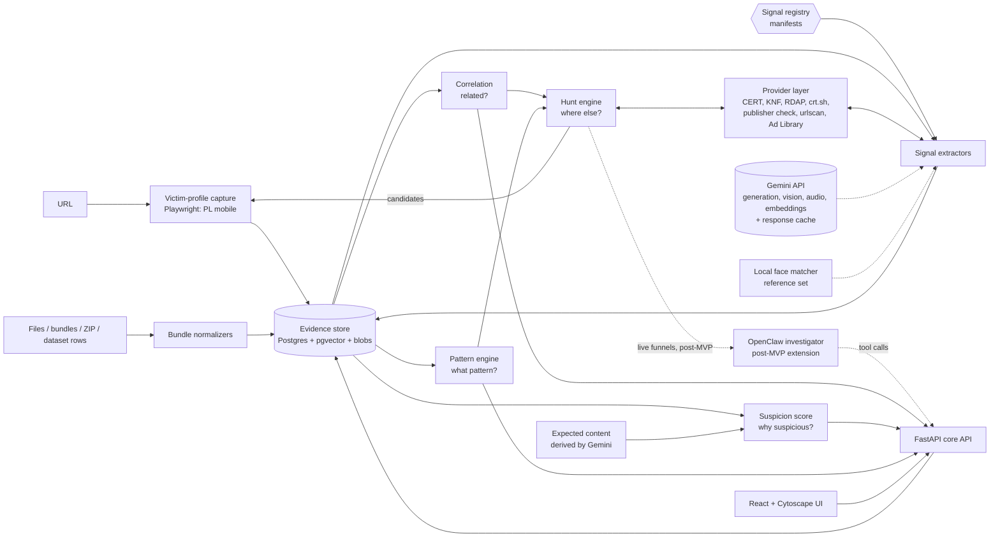

# Follow the Fake — Requirements & Architecture v1.7

*HackNation · NASK challenge "Kolekcjoner fejków" · team of 4–5 · ~24h · drafted 2026-11-21*

> **What changed in v1.7.** Expected-content profiles (§13) follow the same principle as patterns: **no hand-written YAML**.
> - Gemini classifies the page type and derives what a legitimate page of that type in Poland/EU would contain or never contain.
> - Gemini checks each item with evidence; generic verifiers (identifier checksums, KNF list, publisher check) confirm what it finds.
> - Expectations that real pages routinely fail are demoted automatically using the benign set (D23).
>
> **What changed in v1.6.** The pattern layer (§10) is **fully automatic**:
> - **No hand-written patterns and no rule format** (`all_of` / `any_of` / `min_any`) (D22).
> - Patterns are discovered by clustering each case's modus-operandi fingerprint: open element tags, a Gemini-written MO profile and its embedding, and deterministic signals.
> - Gemini writes each pattern's description card and judges whether a new case follows a pattern.
> - LLM errors are contained: patterns never merge campaigns.
>
> **What changed in v1.5.** Review of external building blocks (§21):
> - **Scoring is now a Fellegi–Sunter match weight with term-frequency adjustment** (§7.3): the model behind Splink. We adopt the method, not the library, for the MVP.
> - **har2tree** (Lookyloo) parses HAR files into a resource tree and adds captcha site keys as operator identifiers.
> - **PlaywrightCapture** (Lookyloo) becomes the capture library if it supports the victim profile (30-minute check at H0–1).
> - **Neo4j** is an optional read-only graph projection for analysts: a stretch goal, never the system of record.
> - **Full Lookyloo/Lacus and the Splink library** are post-MVP.
>
> **What changed in v1.4.**
> - The **funnel investigator is a post-MVP extension** (§14). It starts only once the MVP is feature-frozen and demo-ready; otherwise after the hackathon. Its contract stays in the doc so it plugs in without changes.
> - **One LLM provider: Google Gemini** (D2). It covers text and vision, OCR, audio transcription and embeddings (`gemini-embedding-2`: text, image, video, audio).
> - The only local model is **face matching**, because LLM providers decline to identify real people from their faces (D7). Hashing and MinHash are deterministic algorithms, not models.
> - MVP Docker Compose: Postgres, API, capture.
>
> **What changed in v1.3.** Simplified for buildability without touching correlation quality (D17). Postgres stays. The full cut list, with what replaced each item, is in §20.
>
> **What changed in v1.2.** Capture and investigation use the **victim profile only** (D4, §5). Cloaking is now detected without a second profile: by comparing our capture with the submitted material, revisits and urlscan views.
>
> **What changed in v1.1.** Added six capabilities, in priority order:
> 1. **Signal registry** (§8)
> 2. **Provider contract** for enrichment (§9)
> 3. **Pattern layer** (§10)
> 4. **Suspicion score** (§11)
> 5. **Hunts** (§12)
> 6. **Expected-content profiles** (§13)
>
> A darknet/leak provider is a placeholder only (§9.4). The investigator moves to §14 and stays in scope, but it is no longer on the critical path. The team plan (§17) is reordered to match.

## 1. How we win

The jury gives 60% of the score to **correlation method (30%)** and **features and data sources (30%)**. A hidden test set mixes new variants of known campaigns with unrelated campaigns. Our strategy:

1. **A scoring method that is concrete, explainable and rarity-aware.** It must be able to say "this is new" or "not enough evidence", not just "most similar".
2. **Features nobody else will have**: ecosystem-specific indicators (pixels, tracker parameters, URL layout, asset filename sets), Polish sources (CERT Polska warning list, KNF warnings, publisher check), patterns and hunts. *Post-MVP*, the funnel investigator adds lead-form and CRM endpoints (§14).
3. **Proof**: an evaluation harness, a feature ablation, robustness to missing data, and a replay mode so judges can verify everything without our API keys.
4. **Four questions, answered separately**:
   - *Is it related?* Correlation (§7).
   - *Is it suspicious, and why?* Suspicion score (§11).
   - *What pattern does it follow?* Pattern layer (§10).
   - *Where else does it appear?* Hunts (§12).

   All four are fed by one signal registry (§8) and one provider contract (§9).

### What beats the base proposal

| Area | Base proposal | This design |
|---|---|---|
| Correlation method | "Transparent pairwise rules" with no specifics | **Fellegi–Sunter match weights** (the record-linkage model behind Splink) with rarity as term-frequency adjustment, evidence *against* a link, a link-type ladder, explicit assignment and abstain rules (§7) |
| Open-set behaviour | Mentioned only | Four outcomes: ASSIGN / NEW CAMPAIGN IN FAMILY / NEW PATTERN / INSUFFICIENT EVIDENCE |
| Capture | One visit | Victim-profile capture (PL mobile, Facebook in-app); cloaking detected by comparing our capture with the submitted material, revisits and third-party scans |
| Funnel | A conceptual loop | *Post-MVP extension:* OpenClaw investigator with action classes, synthetic personas, budgets, recorded "tapes"; funnel-derived indicators score as the strongest tier (§14) |
| Explanations | An evidence list | Evidence list + how rare each match is + a counterfactual ("without the pixel this link drops to kit level") + a sentence built from the signals' `explain` templates |
| Verification | A metrics table | Labelled evaluation harness, ablation, missing-modality degradation curve, cached replay |
| Indicators | Generic | Built for this scam ecosystem, from the samples: Meta pixel, AW-/G-/GTM IDs, tracker parameters, URL parameter layout, asset filename sets |
| Adding signals | New code per analysis | One plugin manifest per signal; scorer, UI and ablation pick it up automatically (§8) |
| Enrichment | A provider layer, but no concrete sources | Same contract, plus Polish sources: CERT Polska warning list, KNF public warnings, publisher check (§9) |
| Patterns | Not modelled | **Discovered automatically** from modus-operandi fingerprints; Gemini writes pattern cards and judges membership; no hand-written rules; a third axis next to campaigns and families (§10) |
| Suspicion | Not separated from correlation | Its own score with a "why suspicious" list and a coverage value (§11) |
| Discovery | A conceptual frontier | Hunts generated from campaign indicators, run against urlscan and Ad Library (§12) |
| Missing content | Not addressed | Gemini derives what a legitimate page of this type should contain, checks it with evidence, and self-calibrates on the benign set; absence stored with proof of what was checked (§13) |

---

## 2. Decision log

| ID | Decision | Source |
|---|---|---|
| D1 | Team of 4–5, ~24h coding window | User |
| D2 | **One LLM provider: Google Gemini**, for semantics, vision/OCR, element and brand detection, page-type classification, audio transcription and embeddings (`gemini-embedding-2`). No second provider, no separate OCR cleanup model, no local CLIP or speech-to-text. Every response is cached by (input hash, prompt version, model), so judges can replay without keys | User (v1.4) |
| D3 | MVP headline: **explainable, rarity-aware correlation + suspicion + patterns + hunts**. Live funnel investigation on OpenClaw is a **post-MVP extension** (§14) | User (v1.4) |
| D4 | Capture and investigation: **victim profile only** (PL mobile, Facebook in-app). Simplified in v1.2 from two profiles; a crawler profile is a later extension | User |
| D5 | *(Post-MVP)* The investigator may **submit lead forms with a synthetic persona**. It never pays, never uses real people's data, never uploads files | User + guardrails (§14.4) |
| D6 | *(Post-MVP)* OpenClaw is the **investigator only**. Capture, features and correlation run outside it, so the scored pipeline works on offline bundles | User |
| D7 | People ID: **local face matching against a small reference set**, combined with names found in text, captions and OCR via Gemini. This is the one model outside the provider: LLM providers decline to identify real people from faces | User; kept local in v1.4 because the provider can't do it |
| D8 | UI: **FastAPI + React + Cytoscape.js** (the live agent view is post-MVP) | User |
| D9 | Store: **Postgres + pgvector** plus a content-addressed blob folder, in Docker Compose. JSONL export. Optional read-only **Neo4j projection** rebuilt from Postgres (D21) | User (Postgres kept in v1.3); Neo4j added v1.5 |
| D10 | Never commit organiser data to Git (brief §8). Commit the replay cache only if it holds derived features, not raw samples | Default |
| D11 | **Build priority**: signal registry → provider contract → pattern layer → suspicion score → hunts → expected-content profiles. The investigator is not in the MVP (D3) | User |
| D12 | Every signal value has three possible states: **present / absent / unknown**. "Absent" requires proof of what was checked | Default |
| D13 | Suspicion and relatedness are **separate scores**. Suspicion never creates a link between cases; relatedness never claims something is a scam | Default |
| D14 | Patterns are a **third axis** and never merge campaigns. This is also what keeps LLM errors in the pattern layer away from campaign links | Default |
| D15 | Darknet/leaked data: a **restricted provider placeholder only**. No raw leak data stored; in production, plug into NASK's own feeds | Default |
| D16 | No scheduler library. Hunts are started from the UI ("Hunt from this campaign", keyword hunt box); periodic refresh is one background loop in the API service. OpenClaw cron is not used | Default (v1.3) |
| D17 | **Simplify infrastructure, never correlation quality.** Signals, providers that feed correlation, evaluation used for tuning, and grouping quality are not cut for simplicity | User (v1.3) |
| D18 | *(Post-MVP)* Lead-form replies: the persona-tagged addresses stay, but incoming email is not processed automatically | User (v1.3) |
| D19 | Pairwise scoring follows the **Fellegi–Sunter model**: each family contributes log₂(m/u) bits, u comes from corpus frequency (term-frequency adjustment), disagreement contributes negative bits, missing contributes 0. Implemented in our own code (~150 lines); the Splink library is post-MVP | v1.5 |
| D20 | Lookyloo building blocks: **har2tree** for HAR parsing (MVP); **PlaywrightCapture** for capture if it supports the victim profile (MVP, conditional); full Lookyloo/Lacus deployment post-MVP | v1.5 |
| D21 | **Neo4j** (Community Edition) is an optional, read-only projection of cases, indicators and typed edges for exploration in Neo4j Browser. It never decides membership; noise values are flagged or not projected | v1.5 |
| D22 | **No hand-written patterns and no boolean rule format.** Patterns come only from automatic clustering of MO fingerprints (§10.2), are described by Gemini, and are matched by similarity + Gemini judgement (§10.3). Analysts may rename or annotate a pattern card post-MVP, but never write rules | User (v1.6) |
| D23 | **No hand-written expected-content profiles.** Page types are open (canonicalised like tags), expectation lists are generated by Gemini per page type and jurisdiction, and checks are done by Gemini with evidence. Deterministic code only *verifies* what Gemini finds (checksums, registries, lists) and enforces the absence rule | User (v1.7) |

---

## 3. Requirements

### 3.1 Must-haves from the brief, with acceptance tests

| # | Requirement | We demonstrate it when… |
|---|---|---|
| R1 | Accept a URL (ad or page), screenshot, HAR, media file, dataset entry or other lead | Any of these can be dropped into Ingest, plus a ZIP or folder of bundles. All 10 sample folders import with no manual steps |
| R2 | Collect automatically: text, keywords, topic, people, logos, visual traits, domains, redirects, links, page structure, domain and infrastructure metadata | The case card shows each feature family with where it came from (text span, image region, request, video timestamp) |
| R3 | Turn materials into comparable features | All features stored in one long table with extractor versions; one feature vector per family |
| R4 | Find duplicates and variants | Samples 1 and 2 come out SAME CAMPAIGN; re-uploading a sample comes out DUPLICATE |
| R5 | Group into campaigns **and groups of campaigns** | Two levels: campaigns and families. On the samples, the "Gazeta" and "37 minut" campaigns form one family through a shared kit |
| R6 | Classify new material: known campaign or new pattern | Leave-one-out and leave-one-campaign-out pass rates reported |
| R7 | Clusters, dependency graph, list of similar incidents | Cytoscape graph + ranked similar-cases list + campaign pages |
| R8 | Show the reasons behind each link | Every edge opens an evidence panel: matched values, rarity ("2 of 37 cases"), feature tier, counterfactual |
| R9 | Simple GUI for the full process | Ingest → case → similar cases → campaign → graph, all clickable |
| R10 | Written methodology | `docs/METHODOLOGY.md`: features, weights, rules, evaluation results |
| R11 | Robust to incomplete data, duplicates and mixed formats | Coverage shown per case and per edge; INSUFFICIENT EVIDENCE outcome; rarity computed over duplicate groups; degradation curve with modalities removed |
| R12 | Repo, install/run instructions, dependencies, container, external-service access, licenses | `docker compose up`; `make replay` runs with no keys; `LICENSES.md` |
| R13 | Optional small set of frequently impersonated people | 20–30 public figures, with sources and photo licenses documented |
| Bonus | Ad-library search, periodic refresh, linking new items to known campaigns | Ad Library adapter + scheduled re-checks of known campaign domains + automatic assignment |
| Org value | Enriched dataset, campaign pattern descriptions, list of metadata sources | Export: `cases.jsonl`, `indicators.csv`, `campaigns.md` (LLM-written profiles grounded in evidence) |

### 3.2 Post-MVP extension: the funnel investigator

Not part of the MVP (D3). These requirements apply when §14 is built.

| # | Requirement |
|---|---|
| F1 | Starting from a URL (uploaded, captured or discovered), the agent explores the funnel: pre-lander → lander → quiz → lead form → thank-you page or messaging handoff |
| F2 | Each step records a **state** (screenshot, DOM, HAR slice), the **action** taken and the **transition**, all into the shared evidence store |
| F3 | When a lead form appears, the agent submits **one** synthetic persona and records the form's POST endpoint, the hidden fields, the redirect and the thank-you page |
| F4 | Indicators found in the funnel (CRM/lead API host, postback URLs, affiliate IDs, call-centre numbers, messaging handles) feed correlation immediately, and the graph updates live |
| F5 | Every investigation is saved as a **tape** that can be replayed in the UI without network access |
| F6 | Hard limits: steps, time, cost, one submission per funnel, and a list of forbidden action classes (§14.4) |
| F7 | A safe test bench: saved sample HTML served locally as a fake funnel, so the agent can be developed while real domains are dead |

### 3.3 v1.1 requirements, in priority order

| # | Requirement | We demonstrate it when… |
|---|---|---|
| X1 | **Signal registry**: a new signal (Meta pixel, lookalike domain, certificate age…) is added with one manifest file plus one extractor function | A signal added live in the demo appears in the evidence panels, the suspicion list and the ablation, with no other code changes |
| X2 | **Provider contract**: every external source returns results in one shape, with its status, timestamps, raw response, restrictions and cache lifetime | CERT list, KNF, RDAP, crt.sh and publisher check all appear in one "sources consulted" panel per case; replay works with no network |
| X3 | **Pattern layer**: open element tags and an MO profile per case; patterns discovered automatically and described by Gemini; new cases matched by similarity + Gemini judgement | The pattern view lists member campaigns, characteristic elements with prevalence, variations and evidence; a new sample is matched to a pattern with an explanation, or flagged as an emerging pattern; `patterns.md` is exported |
| X4 | **Suspicion score**: a separate, explained triage score with coverage | Each case shows a suspicion band, a "why suspicious" list and its coverage. Benign comparison pages score low |
| X5 | **Hunts**: generate searches from a campaign's indicators and run them against outside sources | A hunt run from a sample campaign returns candidates, they are captured, and at least one is assigned or flagged as new |
| X6 | **Expected-content profiles**: Gemini derives, per page type, the items a legitimate page would carry (and claims it would never make); absence is a signal | A shop page shows "seller identity: absent (searched footer, /kontakt, /regulamin)" with the expectation Gemini generated for that page type; a cloaked capture shows "unknown", not "absent"; an expectation most real pages fail is demoted automatically |

### 3.4 Non-functional

- Runs on a single laptop. No GPU required: the only local model is face matching, which runs on CPU for tens to hundreds of cases.
- Untrusted content: scam HTML is parsed, never rendered outside a sandboxed browser. Page text reaches the LLM only marked as untrusted.
- Reproducible: deterministic extractors are versioned; Gemini responses are cached; post-MVP agent runs are taped.

---

## 4. Architecture overview



**Components**

| Component | Responsibility | Notes |
|---|---|---|
| Bundle normalizers | Detect and parse: Chrome "Save as" (`*_files/`, `.pobrane`/`.pobierz`), HAR, PNG/JPG, MP4, yt-dlp `info.json` (Ad Library), `page-capture` manifest (`dom.html`, `page.har`, `screenshot.png`, `resources/`), ZIP, CSV/JSONL rows | One sample folder becomes one Case with many Observations. Sample 61 = an ad plus 3 pages. HAR files (uploaded or captured) are parsed with **har2tree** into a redirect/resource tree |
| Capture service | One visit per URL with the victim profile (§5), via **PlaywrightCapture** (Lookyloo's capture library) if the H0–1 check passes, else plain Playwright; records HAR with bodies, DOM, full-page screenshot, cookies, final URL, redirect chain, TLS certificate details; outcome = ok / partial / dead / blocked / decoy_suspected | Runs in its own container, with no access to the internal network |
| Signal registry | Loads signal manifests at startup; the single list that the scorers, pattern engine, UI and ablation all read (§8) | YAML in `signals/`, validated by Pydantic |
| Signal extractors | Independent extractors, one per signal or per group of signals (§6, §8); one failing doesn't block the others | In-process thread pool inside the API service; no job queue, no Temporal |
| Provider layer | All outside lookups behind one contract, with a cache and replay (§9) | Rate limits and API keys live in the provider config, never in prompts |
| Pattern engine | MO fingerprints → automatic clustering of campaigns → Gemini pattern cards → Gemini judge for new cases (§10) | Same average-linkage clustering as campaigns; Gemini calls cached |
| Suspicion scorer | Noisy-OR over risk and expectation signals, with coverage (§11) | Deterministic; no LLM involved |
| Expected-content checker | Gemini-generated expectation set per page type → Gemini check per case → present / absent / unknown with evidence; deterministic verifiers and the absence rule on top (§13) | Expectation sets cached per page type + jurisdiction + prompt version |
| Hunt engine | Runs hunts started from the UI, dedupes results, sends candidates to capture (§12) | Plain function + one background loop for refresh |
| Evidence store | Postgres (metadata, features, edges, Gemini/provider cache) + pgvector (Gemini embeddings) + `blobs/sha256/…` | Rarity counts are a single SQL query over the features table |
| Correlation engine | Candidate generation → pairwise assessment → grouping → assignment (§7) | Pure Python, deterministic given the features |
| OpenClaw investigator *(post-MVP)* | Explores funnels through its browser tool and reports through our tool server (§14) | Pinned version, our skill only, no ClawHub skills; adds OpenClaw + mitmproxy containers when built |
| FastAPI core API | REST API (the UI polls every 2 s for live views); serves the built React app as static files | One service. MVP Docker Compose: **Postgres, API, capture** |
| Neo4j projection *(optional, stretch)* | Rebuilt from Postgres after each run: cases, indicator nodes, typed edges (§21.2) | Neo4j Community Edition container; added only if the team is on track at H16 |
| React UI | **Four screens**: (1) case list + ingest; (2) case card with similar cases, "why linked", "why suspicious", "sources consulted" (the investigation tape is added post-MVP); (3) campaign / family / pattern page with its hunts; (4) graph | Cytoscape.js with fcose layout; patterns as an overlay/filter. Evaluation results are a static HTML report from the harness |

---

## 5. Victim-profile capture

One capture profile (D4, simplified in v1.2), used by the capture service and, post-MVP, by the investigator's browser (§14).

| Profile | Settings |
|---|---|
| **Victim** | iPhone viewport + UA, `pl-PL`, `Europe/Warsaw`, Facebook in-app browser UA token, `fbclid` and original ad URL parameters kept, Meta referrer |

- One observation per visit, stored under the URL entity. Revisits (refresh, hunts) add more observations, never overwrite.
- Capture outcome: `ok / partial / dead / blocked / decoy_suspected`.
- **Cloaking signals that don't need a second profile** (each stored as a signal):
  - **Comparison with the submitted material.** The uploaded screenshot, HAR or ad creative shows a scam page, but our capture of the same URL shows something else: pHash, DOM and title differ.
  - **Decoy-page heuristics**: generic blog/portal text, no CTA or form, while the ad creative promises an offer.
  - **Known cloaker and tracker parameters**: `clickid`, `_trk`, `land_id`, `_camp_id`, `lpkey`.
  - **Changes over time**: a revisit shows different content for the same URL.
  - **Third-party views (free crawler perspective)**: urlscan scans of the same URL from the provider layer (§9), compared with our capture.
- **The cloak behaviour itself is a fingerprint.** Sample 61: glowpixel.org served a "media analysis portal" decoy in one capture and the "Trwały Działunek" scam in another, with the same `utm_*` values. That's exactly the comparison with submitted material described above.
- A desktop "crawler" profile is a post-hackathon extension behind the same capture interface.
- Record the capture origin (network, IP country) as metadata on every observation.

---

## 6. Feature catalogue

Weight tiers (feeding §7): **S** = operator identifier, **A** = kit/template, **B** = creative, **C** = theme, **D** = weak infrastructure.

| Family | Features | Tier | Seen in samples |
|---|---|---|---|
| Ad-platform IDs | Meta pixel (`fbq init`, `/tr?id=`, `pxl=`), Google Ads `AW-`, GA4 `G-`, `GTM-`, ad/adset/campaign IDs in URLs | S | Pixel `2012165449475163` shared by 1 & 2; `AW-18463917747` shared by 61/s1 & 61/s2; `ad_id`/`pxl` in 14 |
| Captcha site keys *(v1.5, via har2tree)* | reCAPTCHA / hCaptcha / Cloudflare Turnstile site keys | S | A site key belongs to one operator's account; shared keys across domains are strong links |
| Resource tree *(v1.5, via har2tree)* | Redirect-chain shape, which domain loaded which resources, third-party domain set (minus the public-library list) | A | Sample 14: tracker → lander → video CDN chain |
| Funnel endpoints *(post-MVP, from the investigator)* | Lead-form POST host + path pattern, CRM/API host, postback URL, thank-you page, call-centre number, `wa.me`/`t.me` handles, affiliate/offer IDs | S | `wa.me`/`t.me` handles and form action URLs already present in saved HTML are extracted in the MVP |
| Ad Library | Advertiser page ID, page name, creation date, ad IDs | S | Sample 5: `playlist_uploader_id`, ad ID `1982065065827084` |
| Rare assets | SHA-256 of images, JS and CSS, excluding the public-library list | S/A | ~15 identical assets in 1 & 2; 7 in 48 & 61/s1 |
| Template / kit | HTML tag-path shingles (MinHash), CSS class vocabulary, asset **filename set** (`01-hero.webp`, `02-szpital.webp`…), script path set, generator/comment strings, favicon hash | A | `main.css` hash links the Gazeta and "37 minut" kits |
| URL parameter layout | Parameter keys + value-shape regex, e.g. `utm_id:[A-Za-z0-9]{20}&utm_medium:[A-Za-z0-9]{10}` ; tracker parameter set | A | Shared by 1, 2 and 61 |
| Cloak behaviour | Difference from submitted material / earlier captures / urlscan views, cloaker parameters, decoy page fingerprint | A | 61 |
| Creative visual | Screenshot / image / keyframe pHash + dHash, **Gemini image embedding** (`gemini-embedding-2`) | B | Shared hero images |
| Creative text | Visible text + **OCR and speech transcript via Gemini** (Polish); Gemini text embedding; MinHash for near-duplicate copy; headline template | B | "37 minut po emisji…" |
| Semantics *(Gemini)* | Scam type (investment / nutra / gambling / fake shop / fake event), lure narrative, product, call to action, impersonated media brand, claimed authority, urgency devices, language | C | Gazeta.pl / TVN24 lookalikes; Metabo RX, Uromexil (nutra); Słodka Bonanza (fake App Store) |
| People | Face matches against the reference set + names in text, captions and alt attributes | C | Brzoska, Olejnik, Morawiecki, Glapiński (filenames/text) |
| Logos / brands | Gemini vision brand detection against a brand list (banks, media, App Store) | C | PKO, Pekao screenshots |
| Domain | RDAP registrar, creation date, TLD, lexical pattern (word+word.live), NS pair; certificate issuer and issue time from capture (`securityDetails()`) or, for offline bundles and dead domains, from crt.sh history | D | civicdaybook.live / acrosscommunities.live |
| Risk flags *(v1.1, §8.3)* | Claimed brand ≠ real domain, typosquat/homoglyph, domain age, certificate age, listed on CERT Polska list, KNF warning match, publisher check failed, cloaking detected | D (as a "same way of operating" vector) + suspicion | Page titles ending in "— Gazeta.pl" / "— TVN24" served from unrelated domains |
| Elements *(v1.1; open tags since v1.6, §10.1)* | Open tags from Gemini with evidence (e.g. celebrity face, bank profit screenshot, fake TV interview still, fake comments, countdown, VSL player…), plus deterministic detectors | C + patterns | `shot-pko.webp`, `marek_bank.webp`, `screen_dash.webp` |
| Expectations *(v1.1; Gemini-derived since v1.7, §13)* | Seller identity, terms, risk warning, named author… as Gemini derives them for the page type; present / absent / unknown | D (as a "same way of operating" vector) + suspicion | — |
| Hosting | IP/ASN (CDN ranges down-weighted to ~0), HTTP server headers | D | Cloudflare everywhere = noise |

**Video:** ffmpeg scene-change keyframes (max 12) → Gemini OCR on keyframes; the audio track (first 90 s) → Gemini transcription. The 339 MB recording is downscaled first. Keyframes also get pHash and Gemini image embeddings.

**Never trust as evidence:** the public-library list (jQuery, `fbevents.js`, Google Fonts, jsdelivr/cdnjs/unpkg), CDN ASNs (Cloudflare 13335, Fastly, Bunny), Meta/Google infrastructure hosts. Maintain this list as data, plus an automatic cut-off: values seen in more than 20% of duplicate groups are dropped.

---

## 7. Correlation method

### 7.1 Duplicates first
- Exact: primary artifact SHA-256 (screenshot, HTML after normalisation, video).
- Near-duplicate: text MinHash ≥ 0.95 **and** screenshot pHash Hamming ≤ 6.
- Duplicates collapse into a **duplicate group**. Rarity statistics are computed over groups, not raw cases, so 50 re-uploads of one ad don't make its pixel look "common".

### 7.2 Candidate generation (the scalability seam)
In the MVP, `candidates(case)` returns **all cases**. At tens to hundreds of cases, comparing every pair is fast, and it gives maximum recall: no relationship is missed because an index didn't surface it.

The function stays as the scalability seam. At NASK scale it becomes the union of an inverted index on tier S/A indicator values, pgvector top-k on Gemini image and text embeddings (already in Postgres), and MinHash LSH buckets. That keeps comparisons from growing with N²; nothing else changes.

### 7.3 Pairwise assessment: Fellegi–Sunter match weights (D19)

This is the probabilistic record-linkage model used by national statistics offices; Splink is a well-known implementation. We implement it directly because our features are sets and vectors, our corpus is small, and we need several link types (see §21.1).

For each family *f*, a pair of cases falls into one **comparison level** ℓ: for example *exact shared value*, *high*, *medium*, *disagree*, or **missing** when either side lacks the data. Each level has two probabilities:
- **m** = P(level | the two cases are linked)
- **u** = P(level | they are not linked)

The family contributes `w_f = log₂(m_{f,ℓ} / u_{f,ℓ})` bits.

| Family type | Levels | How u is set | How m is set |
|---|---|---|---|
| Set-valued identifiers (pixels, asset hashes, site keys, contacts, URL layout) | shared value / no shared value | **Term-frequency adjustment**: for a shared value v, `u(v) = (df_groups(v) + 1) / (G + 2)`, so rare values give many bits and CDN IPs or jQuery give ~0. With several shared values, the family takes the rarest one plus a capped bonus for each extra independent value | From the manifest (`m`), defaulting by tier: S 0.9 · A 0.8 · B 0.7 · C 0.6 · D 0.5 |
| Similarities (pHash, Gemini embeddings, MinHash, DOM shingles) | exact / high / medium / low | **From the corpus itself**: the share of all case pairs that land in each level (with N cases there are N(N−1)/2 pairs, almost all unrelated, so u is estimable even at 50 cases) | From the manifest, per level |
| Theme (people, narrative, scam type) | same / different | Term frequency of the value (a celebrity used by many campaigns gives few bits) | From the manifest |

```
M        = Σ_f w_f                       # match weight in bits; missing families add 0
p        = 2^(λ + M) / (1 + 2^(λ + M))   # λ = log₂ prior odds; shown as bits until calibrated
coverage = Σ_compared tier_weight(f) / Σ_applicable tier_weight(f)   # tier weights S5 A3 B2 C1 D0.5, used only for coverage
```

**Gains over the previous weighted mean:**
- **Evidence against a link counts.** Different narrative + different creative + different infrastructure gives negative bits. That's what lets the system refuse to link unrelated material, which the hidden test checks.
- **Rarity and weights come from one principle**: u *is* rarity. CDN IPs and public libraries fall to ~0 bits without special cases; the noise list stays as a safety net.
- **Missing data is neutral by construction**, and coverage still reports how much was compared.
- **A per-pair waterfall** (bits per family) is the explanation.
- The method is a citable standard for the methodology document.
- If labels accumulate, m can later be learned (EM or supervised) without changing the model.

### 7.4 Link-type ladder (rules, evaluated top-down)

| Type | Rule (initial) | Meaning |
|---|---|---|
| DUPLICATE | §7.1 | Same material |
| SAME CAMPAIGN | An S family contributes ≥ τ_S bits (a rare shared identifier) **and** the B or C families are not negative; **or** A and B families each ≥ τ_AB bits; and in all cases M ≥ τ_M | Variant of the same message by the same operator |
| SHARED OPERATOR | An S family ≥ τ_S bits, but the B and C families are negative (different creative and narrative) | Same actor, different campaign → family |
| SHARED KIT | A families ≥ τ_A bits, no S family positive | Same template/toolkit; may be different actors → family (shown with a weaker style) |
| SHARED THEME | Only C families positive | Context only; **never groups cases** |

Every edge stores: type, match weight M, p, coverage, a list of `{family, level, bits, value, u, evidence_ref}`, and a **counterfactual**: the weakest single removal that would lower the link type.

### 7.5 Grouping
- **Campaigns**: average-linkage agglomerative clustering (scipy) over DUPLICATE and SAME CAMPAIGN edges (distance = 1 − p), cut at τ: a member's mean p to its campaign must be ≥ τ. Average linkage prevents chaining by design. Leiden is an alternative to compare in evaluation only if time allows.
- **Families**: campaigns connected by SHARED OPERATOR or SHARED KIT edges.
- Grouping is recomputed on each run. A run log (`runs` table: inputs, method version, thresholds, resulting groups) keeps results reproducible and comparable.

### 7.6 Assigning new material

| Outcome | Condition |
|---|---|
| ASSIGN to campaign X | Best SAME CAMPAIGN support ≥ τ_assign and coverage ≥ c_min |
| NEW CAMPAIGN IN FAMILY Y | Only operator- or kit-level links |
| NEW PATTERN | No link above theme level, with coverage ≥ c_min |
| INSUFFICIENT EVIDENCE | coverage < c_min. The UI suggests the next step (capture the URL, run a hunt) |

### 7.7 Explanations
- An evidence panel (structured, always shown) with a **waterfall of bits per family**, including negative bars for disagreeing families.
- A sentence assembled from the matched signals' `explain` templates (§8.1), e.g. "Both pages load Meta pixel 2012… (seen in 2 of 37 groups, +11 bits); 15 identical images (+6 bits); different narrative (−2 bits)." Deterministic, no LLM call, nothing to cache.
- The counterfactual, e.g. "Without the pixel this link drops to SHARED KIT."

---

## 8. Signal registry — priority 1

Every signal is a plugin: **one manifest file + one extractor function**. The correlation scorer, suspicion scorer, pattern engine, evidence panels, "sources consulted" panel and ablation all iterate over the registry. Adding a signal touches nothing else.

### 8.1 Manifest

```yaml
# signals/meta_pixel.yaml
id: meta_pixel
version: 1
kind: identifier            # identifier | similarity | element | risk_flag | expectation | external_assertion
family: ad_platform_ids
tier: S                      # correlation tier (§6); omit for suspicion-only signals
value_type: set[str]
extractor: ftf.signals.network:meta_pixel
noise_filter: public_library_list
m: 0.9                       # Fellegi–Sunter m for "shared value" (§7.3); u comes from corpus frequency
explain: "Both pages load Meta pixel {value} (seen in {df} of {G} groups, {bits:+.0f} bits)"
---
# signals/brand_domain_mismatch.yaml
id: brand_domain_mismatch
version: 1
kind: risk_flag
family: impersonation
applies_to: [news_article, online_shop, app_store_page, investment_offer]
value_type: {claimed_brand: str, claimed_domain: str, actual_domain: str}
extractor: ftf.signals.brand:brand_domain_mismatch
providers: [brand_list]
suspicion: {strength: 0.6, independence_group: impersonation}
operating_vector: true       # also counts toward the "same way of operating" vector (tier D)
explain: "Page presents itself as {claimed_brand} ({claimed_domain}) but is served from {actual_domain}"
```

### 8.2 Extractor contract

```python
def extract(obs: Observation, ctx: Ctx) -> list[SignalValue]: ...

class SignalValue(BaseModel):
    signal_id: str
    signal_version: int
    status: Literal["present", "absent", "unknown"]   # D12
    value: Any | None
    confidence: float                                  # 0..1
    evidence: list[EvidenceRef]                        # text span, image bbox, DOM node, request, video timestamp
    checked_scope: list[str] = []                      # required when status == "absent"
    provider_results: list[str] = []                   # ids of provider results used (§9)
```

Rules:
- `status = unknown` whenever the input was missing, the capture was partial or cloaked, or a provider was unavailable. Unknown lowers coverage; it never counts as evidence for or against.
- `status = absent` requires `checked_scope` (e.g. `["footer", "/kontakt", "/regulamin"]`).
- Signal values are stored as rows in the `features` table (§16). Rarity counts keep working unchanged.

### 8.3 Where each kind of signal goes

| Kind | Correlation (§7) | Suspicion (§11) | Patterns (§10) | Examples |
|---|---|---|---|---|
| `identifier` | Yes, weighted by rarity, at its tier | No | No | Meta pixel, AW-ID, rare asset hash, lead-API host |
| `similarity` | Yes, at its tier | No | No | pHash, Gemini embeddings, MinHash, DOM shingles |
| `element` | Tier C only | Small, optional | **Yes** | Celebrity face, bank screenshot, fake comments |
| `risk_flag` | Tier D, through the "same way of operating" vector | **Yes** | Yes | Brand/domain mismatch, typosquat, domain under 14 days old, certificate under 7 days old, cloaking |
| `expectation` | Tier D, through the "same way of operating" vector | **Yes** | Yes | Seller identity absent, risk warning absent |
| `external_assertion` | Only if the provider returns an identifier | **Yes** | No | Listed on CERT Polska list, KNF warning match, article not found at publisher |

### 8.4 Initial v1.1 signals (beyond §6)

| Signal | Kind | Provider |
|---|---|---|
| `brand_domain_mismatch` | risk_flag | brand list |
| `typosquat_homoglyph` (edit distance and Unicode confusables against brand domains, punycode) | risk_flag | brand list |
| `domain_age_days`, `cert_age_days` | risk_flag | RDAP; capture `securityDetails()`; crt.sh history for offline bundles and dead domains |
| `cert_free_dv` (weak; most legitimate sites use free CAs and Cloudflare hides the origin certificate) | risk_flag, strength 0.05 | capture / crt.sh |
| `cloaking_detected` | risk_flag | capture (§5): comparison with submitted material and earlier captures, urlscan views |
| `cert_polska_listed` | external_assertion | CERT Polska warning list |
| `knf_warning_match` | external_assertion | KNF public warnings |
| `publisher_article_verified` | external_assertion | publisher check (§9.3) |
| Open element tags (canonicalised) | element | Gemini vision/text, DOM rules, local face match (§10.1) |
| Expectation signals (Gemini-derived per page type) | expectation | §13 |

**Ablation and the live demo.** Turning a signal off is a config flag (`enabled: false`), so the ablation chart (§15) is generated by looping over the registry. In the demo, add a manifest live and re-score.

---

## 9. Provider contract — priority 2

Every outside lookup goes through one interface. That makes sources replaceable, cacheable and replayable.

### 9.1 Interface

```python
class Provider(Protocol):
    id: str
    version: str
    caps: ProviderCaps   # query types, auth, rate limit, cost, history depth, restricted: bool

    def query(self, q: ProviderQuery) -> ProviderResult: ...

class ProviderResult(BaseModel):
    provider_id: str
    query: ProviderQuery                 # reproducible
    retrieved_at: datetime               # when we asked
    observed_at: datetime | None         # when the provider saw it (historical data)
    status: Literal["found", "not_found", "unavailable", "error", "rate_limited"]
    raw_ref: str                         # blob sha256 of the raw response
    assertions: list[Assertion]          # parsed findings
    restrictions: list[str]              # e.g. "no_redistribution", "restricted_pii"
    cost: float
    cache_ttl: timedelta

class Assertion(BaseModel):
    subject: str            # domain / url / indicator / case
    predicate: str          # "listed_on", "registered_at", "article_found", "seen_on_page" …
    object: Any
    independence_group: str # several services repeating one upstream source count once
```

### 9.2 Rules
- `not_found` **never** means benign; `unavailable` / `error` / `rate_limited` become `unknown` and lower coverage.
- Third-party verdicts ("malicious") are stored as assertions, kept apart from our own observations, and shown with their source.
- Every response is cached in `provider_cache` keyed by (provider, version, normalised query). `make replay` serves only from the cache.
- Cache lifetime by type: bulk lists hourly or daily (stored as versioned snapshots), RDAP 7 days, DNS 1 hour, urlscan 1 day, publisher check 1 day.

### 9.3 Initial providers

| Priority | Provider | Use | Access |
|---|---|---|---|
| P1 | **CERT Polska warning list** | `cert_polska_listed`; campaign lexical-pattern hunts (§12) | Public, free; bulk TXT/JSON at `hole.cert.pl/domains/v2/` |
| P1 | **RDAP + DNS** | Domain age, registrar, NS, A records | Public |
| P1 | **crt.sh** | Certificate history for **offline bundles and dead domains** (issue time, issuer, names on the certificate), the only certificate source when we can't visit the site. Live captures read certificates directly | Public |
| P1 | **Brand list** | Baseline for brand/domain mismatch and lookalike checks | Kept by us: ~30 PL brands (media, banks, App Store, InPost…) and their real domains |
| P1 | **Publisher check** | Is the claimed article on the real publisher's site? Gemini extracts publisher, headline, author and date → site-restricted search through **Gemini's Google Search grounding** + the publisher's sitemap/RSS → found / not found / different. Author existence checked the same way | Same Gemini key (verify that site-restricted queries work through grounding on day one; sitemap/RSS is the fallback) |
| P2 | **KNF public warnings** | `knf_warning_match` for investment pages (entity names, domains) | Public page `knf.gov.pl/dla_konsumenta/ostrzezenia_publiczne`; scraped snapshot |
| P2 | **Meta Ad Library** | Advertiser's other ads, page age; hunt source | API token or yt-dlp `facebook:ads` (as in sample 5) |
| P2 | **urlscan.io search** | Hunt source: DOM hash, page title, outgoing link domains, fuzzy brand-domain search | API key; some fields need the paid tier |

### 9.4 Restricted providers (darknet / leaks): documented here only, no code
- The interface is there (`caps.restricted = true`). Results may only carry **scammer-side indicators** (domains, pixel IDs, Telegram handles, wallets) as assertions. Raw dumps are never stored; personal data from leaks is never stored.
- Not built in the hackathon. Production path: NASK/CERT Polska's own leak and threat-intelligence feeds behind the same contract.

---

## 10. Pattern layer — priority 3 (fully automatic since v1.6)

A **pattern** describes *how* a scam operates (its modus operandi), not *who* runs it. It spans many campaigns. It is the "description of campaign patterns" NASK asks for. Patterns never merge campaigns (D14).

**Nothing in this layer is written by hand, and there is no boolean rule format (D22).** Patterns come from two automatic sources, fingerprints and Gemini. Matching is similarity plus Gemini judgement. The same scheme shows up with different parts (an article or a video, a bank screenshot or a crypto dashboard), and rules would miss those variations.

### 10.1 Modus-operandi (MO) fingerprint per case

Produced inside the existing Gemini extraction call (§6), so it adds no extra calls.

| Part | What it is | Notes |
|---|---|---|
| **Open element tags** | Gemini tags what it sees on the page, in images and in video keyframes: free-text tags, each with evidence (bbox / text span / DOM node / timestamp) and a confidence | The list below is only **examples in the prompt**, not a closed vocabulary. Tags without evidence are dropped |
| **Canonical tags** | Tags are embedded with `gemini-embedding-2` and near-identical ones are merged ("fake comments" ≈ "fake testimonials" → one canonical tag) | New canonical tags appear automatically as data arrives. Canonical tags are weighted by rarity, so ubiquitous tags count less |
| **MO profile** | A structured free-text description written by Gemini: lure/hook, impersonated entities and claimed authority, social proof, urgency devices, conversion mechanism (form, call-back, messenger, app install, payment), promised outcome, target audience, language and register | Each claim cites evidence; ungrounded claims are dropped |
| **MO embedding** | `gemini-embedding-2` over the MO profile | Captures "same scheme, different wording/creative" |
| **Deterministic MO vector** | Risk flags (§8.4), expected-content results (§13), funnel structure (redirect depth, tracker type, cloaking), plus deterministic detectors: fake-comment DOM blocks, timers, forms, video players, local face matches | No LLM involved; anchors the fingerprint |

Example tags (prompt hints only): celebrity face, celebrity name in headline, bank or trading-app screenshot, profit claim, fake TV-interview still, fake news-portal layout of a known brand, fake App Store layout, scandal or tragedy hook, fake comments, countdown / limited slots, quiz, lead form, sales-video player, doctor or authority claim, before/after images, crypto dashboard, prize wheel.

The samples already show one scheme this way: `shot-pko.webp`, `shot-pekao.webp`, `06-bank-kacper.webp` (1/2) and `marek_bank.webp`, `screen_peka.webp`, `screen_dash.webp` (3), each next to a celebrity scandal headline.

### 10.2 Pattern discovery (automatic, every run)

1. **Aggregate per campaign**: tag prevalence within the campaign, mean MO embedding, and the deterministic MO vector. A case not yet in any campaign counts as a campaign of one. Cases from the benign comparison set are excluded.
2. **Cluster campaigns by MO similarity**:
   `d = 1 − (α·cos(MO embeddings) + β·rarity-weighted Jaccard(canonical tags) + γ·Jaccard(deterministic MO vectors))`
   using average linkage cut at τ_P, the same method as for campaigns. α, β, γ and τ_P are tuned in evaluation (§15).
3. **Status**: a cluster with 2 or more campaigns is an **established pattern**; a cluster of one is an **emerging pattern**. That's how new schemes surface.
4. **Pattern card by Gemini**, generated from the members' MO profiles and evidence:
   - a name
   - how the scheme works, step by step
   - characteristic elements with prevalence ("bank screenshot in 4 of 5 campaigns")
   - variations between member campaigns
   - what distinguishes it from the nearest other pattern

   Every statement cites member evidence; ungrounded statements are dropped.
5. **Stable identity across runs**: a cluster inherits the ID of the previous pattern whose membership it overlaps most (Jaccard ≥ 0.5); otherwise it gets a new ID. The card is regenerated only when membership changes.

The card's characteristic elements are **descriptive, never a rule**.

### 10.3 Matching a new case (soft, judged by Gemini)

1. **Candidates**: the top 3 patterns by fingerprint similarity to their members (best member and centroid), using the distance from §10.2.
2. **Gemini judge**: receives the pattern card, the MO profiles of 2 representative members, and the new case's MO profile with evidence. It returns:
   - a verdict: *follows / partially follows / does not follow*
   - a confidence
   - shared characteristics and differences, each citing evidence
3. A case can follow several patterns. If it follows none, the UI says "no known pattern", and the case becomes an emerging pattern at the next run.
4. Judgements run at temperature 0, are cached by input hash and prompt version, and replay without keys.

### 10.4 Guardrails for relying on the LLM

- **Evidence is required** for every tag, profile claim, card statement and judge reason.
- **Containment**: pattern similarity feeds correlation at tier C only, and patterns never merge campaigns (D14). A wrong LLM judgement can't create a false campaign link.
- **Suspicion** uses verdict × confidence (§11), never a bare label.
- **Checks** (§15):
  - stability: re-run with one campaign removed and compare pattern membership
  - judge consistency: on a sample, swap the order of the representative members and compare verdicts
  - benign pages must not "follow" scam patterns
- **Cost**: tags and MO profile come from the existing extraction call; plus one card call per changed pattern per run, and at most 3 judge calls per new case.

### 10.5 Outputs
- A pattern view on screen 3: the card, member campaigns and families, element prevalence, variations, example evidence, and status (emerging / established).
- A graph overlay filter.
- `patterns.md` export of all cards, an NASK deliverable.
- Pattern similarity (MO embedding + canonical-tag Jaccard) feeds correlation at tier C.
- Post-MVP: analysts can rename or annotate cards (not write rules), and frequent-itemset mining can be added as a second discovery source at larger scale.

---

## 11. Suspicion score — priority 4

A triage score, separate from relatedness (D13). The brief doesn't ask for a perfect detector; this exists to explain why a case looks suspicious and to rank hunt candidates.

```
suspicion = 1 − Π_g (1 − max_{i ∈ g} p_i)    # noisy-OR across independence groups g;
                                             # within a group, only the strongest present signal counts
coverage  = (# applicable signals with status ≠ unknown) / (# applicable signals)
```

- `p_i` is the `suspicion.strength` from the signal's manifest. Starting values are set by hand, then checked against the benign comparison set (§15).
- Bands: **low / medium / high**, or **unknown** when coverage < 0.4. Shown as a band, not a probability, until calibrated.
- UI: a "why suspicious" list mirroring "why linked", where every item shows its evidence and its source.

Example (sample 1):
- `brand_domain_mismatch` (Gazeta.pl on civicdaybook.live): 0.6
- `publisher_article_verified = not_found`: 0.4
- follows the pattern Gemini named "Celebrity scandal → secret investment platform" (judge confidence 0.9): 0.5 × 0.9
- `domain_age_days < 30`: 0.3

→ **high**, coverage 0.8.

---

## 12. Hunts — priority 5

A hunt takes something we already know (a campaign, a pattern or an indicator) and turns it into queries against outside sources. Results enter as candidates and go through the normal pipeline.

### 12.1 Generated queries

| Seed | Source | Query |
|---|---|---|
| Rare asset hash / DOM hash | urlscan | `hash:` / `dom.hash:` |
| Page title template | urlscan | `page.title:` with variable parts wildcarded |
| Claimed brand | urlscan | Fuzzy or regex domain search excluding the real domain |
| Outgoing link or lead-API host | urlscan | `links.domains:` / `domain:` |
| Headline keywords, impersonated persons, advertiser page ID | Meta Ad Library | Keyword (in Polish; no automatic translation) / page ID |

### 12.2 Lifecycle
1. An analyst clicks **"Hunt from this campaign"** (queries generated from its rare indicators and its pattern) or types into the **keyword hunt** box (celebrity names, scam types).
2. Each result becomes a candidate tagged with `hunt_id` and the query.
3. Dedupe against the corpus.
4. Send the first N candidates (default 10 per query) to victim-profile capture, then extraction, assessment and assignment.
5. *(Post-MVP)* Send live funnels to the investigator queue (§14).

**Periodic refresh:** one background loop re-captures known campaign domains (hourly in the demo, daily otherwise), recording liveness, content drift and whether the page started cloaking.

**On the campaign page:** each hunt's queries, candidates and how many became validated cases.

---

## 13. Expected-content profiles — priority 6 (derived by Gemini since v1.7)

Scam pages often lack what a legitimate page of the same kind must carry: seller identity on a shop, a licensed-entity reference and risk warning on an investment offer, a named author on a news article. **Nothing here is written by hand (D23).** Gemini derives the expectations; deterministic code verifies what Gemini finds and enforces when "absent" may be claimed.

### 13.1 Page type (open)
- Gemini classifies what the page presents itself as ("news article", "online shop", "investment platform sign-up", "supplement sales page", "app store listing", "investment event"…). It returns a confidence and evidence, in the same extraction call as §6.
- Types are **open** and canonicalised by embedding, like element tags (§10.1): "e-commerce store" ≈ "online shop". The list above is only prompt examples.

### 13.2 Expectation set per page type
For each canonical page type and jurisdiction (default Poland / EU), Gemini generates:
- **Expected items** that a legitimate page of this type would normally carry, each with a short rationale, an importance (high / medium / low), and what would count as evidence of presence.
- **Forbidden claims** that a legitimate page of this type would never make (e.g. guaranteed returns, curing disease).

Rules for the set:
- It is generated **once per page type** and cached by (page type, jurisdiction, prompt version). Every case of that type is checked against the same list, so results stay comparable across cases and the MO vector stays consistent.
- It is visible in the UI and exported, so judges and analysts see exactly what was expected.
- It is labelled as **typical expectations from model knowledge, to be confirmed with NASK mentors, not legal advice** (O9).

### 13.3 Checking a case
1. Gemini checks each expected item and forbidden claim against the captured content: visible text, footer, link texts, OCR of images, form fields. It returns *present* (with evidence), *absent* (with the scope it searched), or *unknown*.
2. **Generic verifiers** confirm what Gemini found. They are not rules about what pages need:
   - Checksums for Polish identifiers Gemini extracts (NIP, REGON, KRS). A present but invalid identifier becomes the risk flag `invalid_company_identifier`.
   - The KNF warning list (§9.3) for named entities.
   - The publisher check (§9.3) for news articles.
3. **Absence rule** (enforced in code, not by the LLM): an item may be `absent` only if the capture outcome is `ok` (not partial or cloaked), page-type confidence ≥ 0.7, and the searched scope is recorded (main page incl. footer; a link pointing to the item, e.g. "Regulamin", counts as present; linked pages are not fetched). Otherwise it is `unknown`.
4. A forbidden claim that is present becomes a `risk_flag` with its evidence.

### 13.4 Suspicion and self-calibration
- **Strength** comes from Gemini's importance through one global mapping: high 0.4, medium 0.25, low 0.1. There are no per-item numbers.
- **Self-calibration on the benign set**: when the benign comparison set (§15) contains pages of the same type, any expectation that **at least half of those real pages fail** is demoted one importance level per run (and dropped at the bottom). The demotion is stored with the set and visible in the UI.
- Missing items and forbidden claims feed suspicion (§11), and they are part of the deterministic MO vector (§10.1), keyed by canonical item IDs.

---

## 14. Funnel investigator (OpenClaw): post-MVP extension

> **Not part of the MVP (D3).** Build it only once the MVP is feature-frozen and demo-ready, or after the hackathon. The MVP already provides the hooks it needs: the victim capture profile, the funnel-endpoint signal family, hunt candidates as its task source, and the API. The agent's LLM is Gemini, like the rest (D2).

### 14.1 Integration contract
OpenClaw runs in a **disposable container**. It gets its browser tool plus **one skill of ours** (`follow-the-fake`), which calls our FastAPI tool endpoints:

| Tool | Purpose |
|---|---|
| `get_task()` | Next funnel lead: URL, case ID, budget |
| `record_step(action, rationale)` | Saves screenshot + DOM + network slice; returns the **state class** (pre-lander / quiz / lead form / thank-you / handoff / payment / dead) and any new indicators |
| `submit_form(form_ref)` | The only path for submitting a form. The server attaches this funnel's synthetic persona (§14.3) and enforces the guardrails |
| `finish(outcome)` | Closes the tape and triggers re-correlation |

**Network capture: mitmproxy.** Our infrastructure features need HAR-level data at every step. All agent browser traffic goes through mitmproxy, with its CA certificate installed in the agent container, and flows are sliced by step timestamps. This doesn't depend on OpenClaw internals. Spike in the first 2 hours.
- **Plan B if it doesn't work by H4:** our own Playwright + LLM loop behind the *same tool contract*. The UI, tapes and correlation don't change.

### 14.2 Loop
1. Get the task.
2. Snapshot; the state class comes back from `record_step`.
3. Choose the action most likely to reveal new evidence (CTA > quiz answer > scroll > wait).
4. Execute it.
5. `record_step`.
6. Stop on: lead form submitted, handoff reached, payment page, dead end, or budget spent.

Budgets: ≤ 15 steps, ≤ 5 min, ≤ €0.50 of LLM spend per funnel, **1 form submission per funnel**.

The agent's browser uses the same **victim profile** as the capture service (§5): PL mobile, Facebook in-app UA, original ad parameters and referrer. That way the funnel it walks is the one a real target sees, and step 1 of a tape is directly comparable with a normal capture.

### 14.3 Synthetic personas
- Generated with clearly fictitious Polish names, a team-controlled catch-all email domain (e.g. `lead-<id>@<team-domain>`), and no national ID numbers ever.
- The persona ID is embedded in the email, so later callbacks and emails can be traced to the exact funnel. Incoming email is **not** processed automatically in the MVP (D18); the team can look at the catch-all inbox by hand.
- **Phone numbers: off by default.** Polish prepaid SIMs must be registered to a person, so any number points back at a team member. Enable only with a number the organiser approves.

### 14.4 Guardrails (enforced server-side, not just in the prompt)

| Allowed | Forbidden |
|---|---|
| Navigate, click, scroll, answer quizzes, submit **one** synthetic lead form | Payment or card fields, real personal data, file uploads, downloading or running files, logins to real accounts, messaging scammers, more than one submission, any non-HTTP(S) scheme |

- Container: no host mounts, outbound internet only (internal and private ranges blocked), no secrets in the agent's context (the LLM key sits in OpenClaw's gateway config, not in prompts), `exec`/`fs` tools denied, pinned OpenClaw version, no third-party skills.
- Page content is treated as untrusted. The tool server ignores any "instructions" coming from page text.
- Get mentor sign-off for synthetic submissions at the start of the event, and record that in the README.

### 14.5 Demo-time reality
- Sample domains from Oct 2026 are likely dead. Fresh funnels come from **hunts** (§12) on the day: Ad Library keyword search on detected narratives and persons, plus urlscan and CERT-list matches. That makes the bonus requirement serve the headline demo.
- Every demo run is taped. If a live run fails on stage, replay the best tape.

---

## 15. Evaluation (feeds the methodology document)

- `labels.yaml`: campaign and family labels for the sample set, extended with the organiser's extra data if released.
- Metrics:
  - pairwise precision and recall per link type
  - B-cubed F1 for campaigns
  - **leave-one-out** assignment accuracy (known variants)
  - **leave-one-campaign-out** NEW-PATTERN rate (unknown campaigns), which is what the hidden test checks
- **Ablation**: drop each family and report the change in F1. This gives the jury a chart of which features matter.
- **Degradation**: randomly remove HAR, screenshot or HTML and plot F1 against modalities available. Demonstrates R11.
- **Pattern layer checks**: membership stability with one campaign removed; judge consistency when the order of representative members is swapped; benign pages must not follow scam patterns; α/β/γ and τ_P tuned so patterns group campaigns that share a scam type in `labels.yaml`.
- Calibration: plot p against the labels; if it is well calibrated, show p instead of bits.
- Pairwise precision/recall per link type and B-cubed F1 stay: they are how the ladder and τ are tuned (D17).
- Results are written as a static HTML report (opened in step 7 of the demo; not a React page).
- Thresholds (τ_A, τ_assign, c_min) are tuned on these runs, frozen at H20, and written into the methodology document.
- **v1.1 additions:**
  - **Benign comparison set** of 10–15 pages: real gazeta.pl and tvn24.pl articles, real shops, a real broker page, a real App Store listing. Report the suspicion false-positive rate, and check that benign pages are **not** linked to scam campaigns.
  - **Expectation checks:** the benign set must not produce `absent` for items a real page clearly has. Expectations failed by at least half the real pages of a type are demoted automatically (§13.4); report how many were demoted per type.
  - **Ablation by registry:** one run per signal or family with `enabled: false`.

---

## 16. Data model (Postgres)

`cases` · `observations(kind: upload | capture | agent_step, url, captured_at, outcome, profile)` (`profile` stays as a column, always `victim` for now) · `artifacts(sha256, mime, size, blob_path)` · `features(case_id, observation_id, family, key, value, vector_ref, evidence_ref, extractor, version)` · `dup_groups` · `edges(a, b, type, score, coverage, evidence jsonb, counterfactual, method_version)` · `campaigns`, `families`, `campaign_membership(run_id, case_id, campaign_id, reason)`, `runs(id, method_version, thresholds, started_at)` · `funnel_steps(...)` · `personas` *(post-MVP tables, created with §14)* · `cache(key, source, version, response, created_at)`: one table for Gemini and provider responses (the replay source)

**v1.1 additions:**
- `signals(id, version, kind, manifest jsonb, enabled)` is loaded from YAML. `features` gains `signal_id`, `signal_version`, `status`, `confidence` and `checked_scope`.
- `provider_results(id, provider_id, version, query jsonb, retrieved_at, observed_at, status, raw_ref, restrictions, cost, assertions jsonb)` — assertions stored inline, each with its `independence_group`.
- `mo_fingerprints(case_id, tags jsonb, mo_profile jsonb, mo_embedding vector, mo_vector jsonb, version)` + `canonical_tags(id, label, embedding, df)`.
- `patterns(id, run_id, status: emerging | established, card jsonb, members, centroid vector)` + `pattern_matches(case_id, pattern_id, verdict, confidence, shared jsonb, differences jsonb, method: similarity | gemini_judge, prompt_version)`.
- `suspicion(case_id, score, band, coverage, contributions jsonb, method_version)`.
- `expectation_sets(page_type, jurisdiction, items jsonb, forbidden jsonb, demotions jsonb, prompt_version)` + `expectation_results(case_id, page_type, item_id, status, checked_scope, evidence, verifier_result)` + `canonical_page_types(id, label, embedding)`.
- `hunts(id, seed_type, seed_id, source, query, schedule, budget, status)` + `hunt_results(hunt_id, candidate_url, found_at, rank, case_id NULL)`.

---

## 17. Team split and 24h plan

**Priority order (D11):** registry → providers → patterns → suspicion → hunts → expected-content profiles. The investigator is post-MVP (D3); T4's freed time goes to hunts, the benign set, labels and evaluation support.

| Track | Owner | Scope |
|---|---|---|
| T1 Ingest, capture & providers | 1 | Normalizers (HAR via har2tree), victim-profile capture (PlaywrightCapture if it fits), **provider layer** (§9) with CERT list, RDAP/DNS, crt.sh, brand list, publisher check, KNF |
| T2 Extractors & patterns | 1 | Gemini extraction (OCR, transcription, semantics, elements, brands in multi-label calls), Gemini embeddings, pHash/dHash, local face matcher + reference set, **pattern engine** (§10) |
| T3 Registry, correlation, suspicion & eval | 1 | **Signal registry** (§8), **Fellegi–Sunter scoring** (m/u, term-frequency adjustment), ladder, average-linkage grouping, assignment, **suspicion scorer** (§11), **expected-content checker** (§13), harness, ablation, METHODOLOGY.md |
| T4 Hunts, data & evaluation support | 1 | **Hunt engine** (§12) with urlscan + Ad Library, periodic refresh, benign comparison set capture, `labels.yaml`, degradation runs. Post-MVP: investigator (§14) |
| T5 UI & delivery | 1 (or shared) | FastAPI API, React/Cytoscape **four screens** (§4) incl. the bits waterfall, optional Neo4j projection (stretch), Docker Compose, README, LICENSES (incl. Gemini terms and the face model's license) |

| Hours | Checkpoint |
|---|---|
| 0–1 | **Contracts frozen**: signal manifest + `SignalValue`, `Provider` / `ProviderResult` / `Assertion`, element vocabulary, profile schema, DB schema, Gemini prompt/response schemas, `labels.yaml`. **30-min check: does PlaywrightCapture support the victim profile** (mobile device, `pl-PL`, `Europe/Warsaw`, referer)? |
| 1–6 | **Working skeleton driven by the registry**: 10 samples → HAR/HTML signals → rarity → edges → API → UI list + graph + evidence panel. Providers working: CERT list, RDAP, crt.sh, brand list (cached) |
| 6–12 | **Patterns + suspicion**: MO fingerprints (open tags + MO profile in the extraction call), automatic pattern clustering + Gemini cards + judge, suspicion scorer, brand/domain mismatch, publisher check. All extractors, ladder, clustering, assignment, eval v1. Victim-profile capture + cloaking signals |
| 12–16 | **Hunts**: urlscan + Ad Library from the campaign page and keyword box; candidates go into capture. **Expected-content profiles**: open page types, Gemini expectation sets + checks, identifier checksums, benign-set demotion; KNF provider. |
| 16–20 | Campaign/pattern page with hunts; periodic refresh. Benign set, eval + ablation + degradation. Stretch if on track: Neo4j projection. **Feature freeze at H20** |
| 20–24 | Docker Compose, `make replay`, README, LICENSES, methodology, `patterns.md`, two demo rehearsals. Investigator (§14) only if everything is green |

**Demo script (7 minutes):**
1. Bulk-import the sample set → campaigns, families and automatically discovered patterns appear, each with a Gemini-written card.
2. Click an edge → evidence, rarity, counterfactual.
3. Open sample 1 → "why suspicious": *poses as Gazeta.pl on civicdaybook.live*, *article not found on gazeta.pl*, *celebrity-scandal investment pattern* → band high.
4. Add a new signal manifest live → the evidence panels and ablation include it right away.
5. Run a hunt from the "37 minut" campaign → new candidates → captured → one joins the campaign, another becomes a new campaign in the same family.
6. Periodic refresh: a known campaign domain changed content or started cloaking since import → shown on the campaign page.
7. Evaluation report: assignment accuracy, unknown-rejection rate, benign false-positive rate, ablation.
8. Export the enriched dataset, `patterns.md` and campaign profiles.

---

## 18. Risks and mitigations

| Risk | Mitigation |
|---|---|
| *(Post-MVP)* OpenClaw traffic can't be captured | mitmproxy spike; otherwise Plan B loop behind the same contract |
| *(Post-MVP)* Agent hijacked through prompt injection; OpenClaw CVEs | Disposable container, pinned version, deny exec/fs, egress-only network, no secrets in context, server-side guardrails |
| Gemini safety filters block analysis of scam content | Configure safety settings for analysis; a blocked call becomes `unknown` (lowers coverage) rather than failing the case; prompts frame the task as fraud analysis |
| Single-provider dependency (outage, rate limits, quota) | Response cache + `make replay`; batching; Gemini errors become `unknown`, so deterministic signals keep the pipeline working |
| Overfitting thresholds to 10 samples | Rarity-based rules generalize; leave-one-campaign-out; thresholds frozen before the extra data arrives |
| *(Post-MVP)* Synthetic leads cause real scammer contact | Email-only by default, mentor sign-off, persona-tagged inbox, one submission per funnel |
| Biometric data (face reference set) | Public figures only, small set, documented sources, local processing, deletable |
| Organiser data leaks | `.gitignore` the samples; replay cache contains derived features only; document what was sent to the Gemini API |
| Five tracks drift apart | Contracts at H1, skeleton at H6, one integration owner (T5) |
| Fellegi–Sunter m values are guesses at the start | Defaults by tier; check calibration against labels (§15); u is computed from data, so most of the weight is not guessed |
| har2tree / PlaywrightCapture quirks or heavy dependencies | Both sit behind our parser and capture interfaces; fall back to plain HAR JSON parsing and plain Playwright |
| Neo4j traversal makes everything look connected (CDN IPs, public libraries) | Projection skips noise-list values or flags them with their frequency; membership comes only from our engine |
| False "absent" results from cloaked or partial captures | Absence rules in §13; `unknown` by default; precision checked on the benign set |
| Gemini expects items that aren't really required (or misses real requirements) | One cached set per page type, visible to everyone; benign-set demotion; importance-based strengths are low; verifiers confirm identifiers; mentor review of important items (O9) |
| Gemini invents page elements or OCR text | Evidence region required (Gemini returns bounding boxes); confidence threshold; verbatim-transcription prompt for OCR; spot checks on the samples |
| Publisher check misses real articles (paywall, renamed URL) | "Not found" is a moderate-strength signal, never decisive; sitemap and search used together |
| Provider keys and rate limits (urlscan, Ad Library) | Provider caps + caching; keys only in config; replay from cache |
| KNF page layout changes | Daily snapshot stored with a version; the parser has tests |
| Hunts only rediscover what we already know | Keyword hunt box for independent searches; per-hunt counts on the campaign page |

---

## 19. Open decisions (current defaults)

| # | Question | Default until decided |
|---|---|---|
| O1 | UI and methodology language | UI in English with Polish labels where they help the jury; methodology in Polish with an English summary; code and README in English |
| O2 | *(Post-MVP)* Phone numbers for synthetic leads | Off unless the organiser provides a number |
| O3 | Which models | **Resolved (D2):** Gemini only. One Gemini model for extraction and semantics, `gemini-embedding-2` for embeddings. A smaller Gemini model only if cost or latency requires it (same provider) |
| O4 | Polish proxy exit for capture | Dropped in v1.3. Capture origin is still recorded |
| O5 | Sending organiser samples to the Gemini API | Confirm with mentors at kickoff; record the answer in the README |
| O6 | Source of the benign comparison set | The team captures 10–15 real pages on day one with the same victim-profile capture |
| O7 | urlscan plan (free vs paid) | Free tier plus caching; paid-only fields are optional |
| O8 | Web search for the publisher check | **Resolved:** Gemini's Google Search grounding, plus sitemap/RSS |
| O9 | Expected-content profiles: legal accuracy | Gemini-generated sets are labelled as typical expectations; confirm the important items with NASK mentors; benign-set demotion removes ones that real pages don't meet |
| O10 | Leak / darknet provider | Placeholder only (D15); revisit with NASK after the hackathon |

---

## 20. v1.3 cut list

Rule (D17): simplify infrastructure, never correlation quality.

| Cut | Replaced by | Why it costs nothing |
|---|---|---|
| Worker job table (`SKIP LOCKED`) | In-process thread pool | No queue needed at MVP volume |
| APScheduler | UI-triggered hunts + one refresh loop | The bonus needs periodic updates, not a scheduler |
| Separate UI container; SSE (server-sent events) | React build served by FastAPI; polling every 2 s | One less service; same on screen |
| MHTML | DOM + HAR + screenshot | Redundant |
| Polish proxy exit | Capture origin recorded | Optional anyway |
| Candidate generation via indexes | All-pairs comparison; `candidates()` kept as the scaling seam | Higher recall at MVP size |
| Leiden + linkage guard | Average-linkage clustering only | Same anti-chaining property; one method to tune |
| Versioned campaign membership | Recompute + run log | No audit trail needed for the brief |
| LLM sentence per edge | `explain` templates from the manifests | Deterministic; no LLM cost |
| Pattern mining (FP-growth) + drift | Automatic MO clustering + Gemini cards (v1.6); mining post-MVP | Too few cases to mine; clustering and the LLM work at small N |
| **v1.6:** hand-written patterns and the `all_of` / `any_of` / `min_any` rule format | Automatic discovery (§10.2) + Gemini judge (§10.3) | Rules are brittle across variations of one scheme; the LLM generalises, with evidence required and contained by D14 |
| **v1.7:** hand-written expected-content profiles (YAML per page type, fixed page-type list, per-item strengths) | Open page types + Gemini expectation sets + Gemini checks + generic verifiers + benign-set demotion (§13) | Covers page types we didn't anticipate; no per-item tuning |
| CLIP zero-shot logos | LLM vision brand detection | Duplicate path |
| Face set of 20–30 | 10–15 people | Enough to show it works |
| Tranco | Brand list | The samples don't typosquat |
| crt.sh as a **hunt** source; CERT-list diff hunts; Cloudflare scanner; KRS/CEIDG/VAT whitelist | urlscan + Ad Library hunts | Hunts don't affect correlation on the test set |
| Automatic hunt creation, ranking formula, 20% seed budget | "Hunt from this campaign" button + keyword hunt box; first N results | Manual control is better for the demo |
| 6 agent tools; CDP capture option | 4 tools; mitmproxy only | Same behaviour; one fewer unknown |
| Separate live view and tape player | One tape component | Same screen |
| ~9 UI screens; React eval page | 4 screens; static HTML eval report | Pattern and hunt views fold into the campaign page |
| Provider and LLM cache tables; separate assertions table | One `cache` table + `provider_results` with inline assertions | Same contract |
| GraphML/Cypher export | JSONL | Neo4j can import JSON |
| Element-accuracy and expectation-precision labelling; hunt-yield metric | Benign-set spot check; counts on the campaign page | Not used for correlation tuning |
| Following links one level deep for expectation checks | Main page + footer; a matching link counts as present | No extra fetches |
| Processing incoming lead email (D18) | Persona-tagged addresses only | Callbacks may not arrive within 24 h |
| **v1.4:** funnel investigator in the MVP (OpenClaw + mitmproxy containers, tool server, personas, tapes) | Post-MVP extension (§14); hooks kept | Not required by the brief; removes the riskiest dependency from the 24 h build |
| **v1.4:** multiple model sources (Tesseract OCR, OCR cleanup model, local CLIP, local text embeddings, local speech-to-text) | **Gemini only**: OCR, transcription, vision, `gemini-embedding-2` for text and image embeddings | One key, one SDK, one cache. Embedding quality is comparable or better across 100+ languages incl. Polish, so correlation quality is not reduced (D17) |

**Considered but kept (they affect correlation quality, D17):**
- **Postgres + pgvector.** Kept at your request.
- **crt.sh as a provider.** The only certificate history for offline bundles and dead domains.
- **The element vocabulary, now open (v1.6).** Gemini proposes tags freely (canonicalised by embeddings), in the same call; it feeds theme-level similarity and the MO fingerprint.
- **dHash** alongside pHash.
- **Per-link-type precision/recall and B-cubed F1.** Used to tune the link-type rules and thresholds.
- **Video speech-to-text.** Narration text feeds creative similarity; now done by Gemini.
- **Local face matching (v1.4).** The single exception to D2: LLM providers decline to identify real people from faces, and `celebrity_face` feeds the people signal and patterns.
- **Separate capture container.** Keeps scam pages isolated from the API.

---

## 21. External building blocks (v1.5 review)

| Tool | What it is | Verdict | Where it lands |
|---|---|---|---|
| **Splink** | Probabilistic record linkage and deduplication (Fellegi–Sunter, term-frequency adjustments, waterfall charts; DuckDB or Spark backends) | **Adopt the model, not the library, in the MVP** | §7.3 scoring (D19). Library post-MVP for NASK-scale deduplication and learned m/u |
| **Neo4j** | Graph database + Cypher; GDS algorithms | **Optional read-only projection** (stretch) | §21.2 (D21). Postgres stays the system of record |
| **Lookyloo** | CIRCL's web capture and analysis platform (domain tree, redirects, cookies, third-party lookups) | **Use two of its libraries now; the platform post-MVP** | har2tree for HAR parsing, PlaywrightCapture for capture (D20); Lookyloo/Lacus later as a production capture backend and analyst tool |

### 21.1 Splink: why the method and not the library (for now)

**Why the method fits:**
- Our scoring was already "independent evidence per family; rare matches count more". That's the Fellegi–Sunter model with term-frequency adjustment, in which a match on a rare value carries more evidence than a match on a common one.
- It's explainable: per-pair waterfall charts show how each piece of evidence adds up to the final score.
- It has a long record in census and national-statistics linkage, which makes it easy to defend in the methodology document.

**Why not the library in 24 hours:**
- **Set-valued features fit badly.** Splink's term-frequency adjustments are based on exact matches in a column, and how they should work for array columns (intersections) is still an open question in the project. Our strongest features are sets (pixels, asset hashes, site keys).
- **Too little data for EM.** Estimating m by expectation-maximisation needs many records. Our ~10–20 sample cases are too few; we set m from the manifests instead.
- **One match probability, but we need a ladder.** Splink gives a single match probability per pair; we derive five link types from per-family weights.
- **Clustering by thresholded connected components** is the chaining behaviour we avoid. We keep average-linkage clustering.

**Post-MVP:** Splink scales to 100+ million records on Spark. That's the path for NASK-scale deduplication of case tables, and for learning m once labelled data accumulates.

### 21.2 Neo4j: optional projection, not the store

Neo4j makes the case–indicator graph easy to explore in Cypher and Neo4j Browser, and the brief names it as one possible direction. We add it as a **rebuildable view**:

- **Nodes**: `Case`, `Campaign`, `Family`, `Pattern`, and one node per indicator value: `Domain`, `IP`, `Pixel`, `AdsId`, `CaptchaKey`, `AssetHash`, `Contact`, `Registrar`, `Person`. Indicator nodes carry `df_groups` and `noise: true/false`.
- **Exact-match edges**: `(:Case)-[:OBSERVED {evidence_ref}]->(:Pixel)` and so on. Shared values become shared nodes, which is what makes multi-hop traces easy.
- **Derived edges** from our `edges` table, typed: `SAME_CAMPAIGN`, `SHARED_OPERATOR`, `SHARED_KIT`, `SHARED_THEME` with `{M, p, coverage, evidence_ids}`. Raw per-family similarities, if useful, go in as `SIMILAR_TO {family: 'text', level: 'high', bits: 3.1}`.
- **Rebuilt** idempotently (MERGE) after each run, so there is no two-way sync. Noise-list values are not projected, or are marked `noise: true` so queries can skip them.
- **Graph algorithms** (GDS Community Edition, GPLv3) include all algorithms with a 4-core limit. That's useful for cross-checking our grouping, not for deciding it.
- **Cost**: one container and ~150 lines. Built only if the team is on track at H16; otherwise post-MVP. Our own UI graph stays Cytoscape.

### 21.3 Lookyloo: libraries now, platform later

- **har2tree (MVP).** Turns a HAR file into a tree: which page or redirect loaded which resource. It also extracts Google tag IDs and reCAPTCHA / hCaptcha / Cloudflare Turnstile site keys. We get a tested HAR parser for the offline samples, the redirect/resource-tree features, and a new tier-S identifier (captcha site keys). Check its license and how much of the tree toolkit it pulls in on day one.
- **PlaywrightCapture (MVP, conditional).** A Playwright capture library (BSD-3-Clause) that returns the HAR, a screenshot, the session's cookies, the final URL and the rendered HTML. Its docs don't list device emulation, locale, timezone or referer options, so check that it can do our victim profile at H0–1. If not, keep plain Playwright.
- **Lookyloo / Lacus (post-MVP).** Lacus is a capture web service built on Playwright that can handle tens of thousands of URLs a day. Behind our capture interface, it's the production path for NASK, and Lookyloo itself gives analysts a deep-dive view per case. Not in the MVP: it adds valkey and several processes, and its analyst UI overlaps with ours. Don't submit organiser samples to CIRCL's public instance.
- **Cloaking limits** apply equally to Lookyloo and to our capture; our comparison with submitted material (§5) is what compensates.

