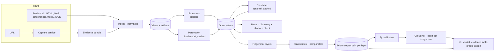

# Follow the Fake — architecture for a 12-hour MVP

Companion to [signal-catalogue.md](signal-catalogue.md), which lists the criteria and signals this design consumes. Written from the challenge brief, [baseline-report.md](baseline-report.md) and a direct probe of `testing_sample/`; no earlier design documents were used.

**Decisions taken from the requirements interview (2026-11-21)**

| Question | Answer | Consequence |
| --- | --- | --- |
| Models | Cloud only | No local model stack. External model APIs and external data services are allowed. All model calls go through one gateway with a content-hash cache. |
| Judging | Organiser runs our Docker | The whole app starts with one `docker compose up` on any machine with internet. No hosted deployment. API keys come from an `.env` file. |
| Input | Live capture is core | A headless-browser capture service with redirect tracing and a cloaking test is in scope, alongside archive ingestion. |
| Team | 2–3 developers | Three parallel tracks joined by three frozen data contracts. |
| Organiser material to commercial APIs | Allowed | Screenshots, page text and video frames may be sent to the model providers. Secrets found in the material are still redacted first. |
| Face-reference matching | Later, if time allows | Not in the core plan. The layer interface is defined so it can be added. |
| Second model provider | Google Gemini | One extra key covers text and image embeddings, speech transcription and direct video input. |
| Patterns | Discovered by the model, not hand-written | No rule files or fixed tag list. The model builds and maintains the pattern library (§6). |
| Expected page elements | Generated by the model, not a hand-written checklist | The model drafts what a legitimate page of each kind should carry and checks each view against it (§6). |
| Regulator lists | In MVP scope | The financial regulator's warning list and the national phishing list are matched on every run; the gambling and supplement registers are included as far as their sites allow (§7). |
| Capture network | Polish network | Country-based cloaking is not expected to hide the offer page. The capture record still notes the egress used. |

These two fit together: the container is only the packaging, and from inside it the app calls external model APIs and public data services. The brief asks that access to such services be documented and does not ask for private keys, so the README explains how to obtain each key and an `.env.example` lists them. The model cache exists for speed, cost and a repeatable demo, not as a substitute for the APIs.

---

## 1. Candidate architectures and evaluation

Four ways to build this, scored against the brief's weighted criteria and the constraints above. Scores are 1 (poor) to 5 (strong) and are a design judgement, not a measurement.

| | A. LLM analyst | B. One embedding space | C. Entity graph | **D. Layered fingerprints + typed evidence** |
| --- | --- | --- | --- | --- |
| **How it works** | An LLM writes a report per item, then compares reports (the baseline, automated) | Everything about an item is concatenated and embedded once; a clustering algorithm groups the vectors | Domains, pixels, assets, people become graph nodes; campaigns are connected components or communities | Each semantic layer gets its own fingerprint and comparator; per-layer evidence is fused into typed relations; the graph is a view of the result |
| Correlation and grouping quality (30%) | 2 — not reproducible; pair comparisons grow quadratically | 2 — cannot tell "same campaign" from "same template" from "same story type" | 4 — exact for identifiers; weak for rewrites and visual variants | **5** — exact where identifiers exist, distance-based where they don't |
| Feature usefulness and variety (30%) | 3 — rich but unstructured | 2 — features dissolve into one vector | 3 — only what can be a node | **5** — every catalogue signal has a home |
| End-to-end completeness (15%) | 4 — fastest to demo | 4 | 3 — graph database setup costs hours | 4 |
| Interpretability (15%) | 3 — fluent but unverifiable | 1 — "these vectors are close" | 4 — paths are evidence | **5** — per-layer evidence table with provenance |
| Deployment, scale, portability (10%) | 1 — cost and latency grow with every pair; results vary between runs | 4 | 3 — a graph database is one more container to run | 4 — one container |
| If a model API call fails | Nothing works | Nothing works | Unaffected | Semantic layers drop out; identity, artifact and kit layers still link |
| Swappable algorithms | No | One model only | Hard | **Yes — per layer** |
| Handles missing data | By prose | Poorly; a missing modality shifts the vector | Yes | **Yes — per-layer, with coverage reported** |
| Chief risk | Invented links | Meaningless clusters | Hub nodes (a CDN, a celebrity) merge everything | More moving parts in 12 hours |

**Decision (confirmed 2026-11-21): D, borrowing one thing from each of the others.** From C, the graph as the presentation (built from D's edge table; no graph database in the MVP). From B, vector search for candidate generation and for the semantic layers. From A, the LLM as the component that reads material, discovers the patterns in it, and narrates evidence that was computed without it.

D's risk — more parts — is handled by making the first four hours produce a working system from deterministic layers only (§14), so everything after that is additive.

---

## 2. Design principles

1. **Linkage and risk are separate.** Risk signals describe one item; linkage signals connect two. Only rarity-weighted linkage signals drive grouping.
2. **The unit of analysis is the view, not the folder.** A view is one captured page, one ad creative, or one video. Folder 2 holds two unrelated pages; folder 61 holds three views of one domain.
3. **A relation has a type.** Two items can be the same campaign, the same production kit, or merely the same playbook. One undifferentiated similarity score hides exactly what the brief asks to be shown.
4. **A fingerprint is whatever suits the layer.** A set of identifiers, a perceptual hash, or a dense vector — each with a comparator that returns a score in [0, 1] plus the evidence behind it.
5. **Missing is not different.** A layer that could not be observed on either side is left out of the comparison and lowers stated coverage; it never counts against a link.
6. **The model perceives and discovers; code decides.** The model reads material and finds the recurring patterns in it. Scores, links and group membership are computed by code, so no link exists because a model said so.
7. **Every value carries its source.** File, locator, raw value, extractor version.
8. **Everything is a registered plugin behind a small interface.** Swapping an algorithm is a configuration change.

---

## 3. System overview



Every stage is a pure function from stored inputs to stored outputs, keyed by content hash and component version. Re-running is free; changing one extractor recomputes only what depends on it.

### Three frozen contracts

These are agreed in the first hour and are the only coupling between the three development tracks.

```text
Observation   view_id, signal_id, namespace, value, raw, state{present|absent|not_observable},
              source{file, locator}, extractor@version, confidence

Fingerprint   view_id, layer_id, kind{set|hash|vector}, payload, layer@version

Evidence      view_a, view_b, layer_id, score[0..1], shared[], differing[], comparator@version
```

`namespace` is what makes identifiers comparable only with their own kind (`fb_pixel`, `aio.campaign_uuid`, `gads_id`, `form_endpoint`…). `signal_id` refers to a row in the signal catalogue.

---

## 4. Ingest and capture

### Archive ingestion

A folder or zip becomes one **incident** containing **artifacts** (files, content-addressed) grouped into **views**:

- a saved HTML file with its `_files/` directory and matching HAR → one *page view*;
- a screenshot or creative image → one *ad view* (or evidence attached to a page view when it is a screenshot of that page);
- a video with its metadata JSON → one *video view*;
- a nested capture bundle (`dom.html`, `page.har`, `screenshot.png`, `manifest.json`, `resources/`) → one page view.

Normalisation rules learned from the sample: choose the HAR's main document by MIME type and host, not by position; strip browser-translate and extension markup before extraction; treat duplicate representations of one capture (HTML, MHTML, DOM snapshot) as one view; detect a HAR named just `.har`. ### Linking views inside one incident

Views are compared one by one, but an ad and the page it leads to are one funnel and must end up in the same campaign. Two kinds of edge exist inside an incident:

- `co_captured` — the views arrived in the same folder. Shown to the analyst, never used for grouping. Folder 2 shows why: it holds two unrelated pages.
- `funnel` — one view leads to another. It is asserted only with evidence: the domain shown in the ad matches the page's host; the page's landing URL carries the ad's ID; the two share a brand, offer or named person; a redirect or stored navigation history connects them; or the ad text and the page are semantically close. Campaign membership propagates along funnel edges.

When an ad and its page do *not* match (cases 10 and 36), no funnel edge is forced. The mismatch is recorded as a cloaking observation, and the pair stays joined by `co_captured` with the submitter's folder as the only stated basis.

### Other starting points

A bare identifier — a domain, a pixel ID, an ad-library ID, a product name — is also accepted. A domain starts a capture and enrichment run. Any other identifier is looked up in the index of already processed material and returns the views that carry it.

### Live capture (core)

A URL is captured by a headless browser into the **same bundle layout the organiser's own capture tool produces**, so a live capture and an archived one enter the pipeline identically.

| Step | What is recorded |
| --- | --- |
| Navigate with full HAR recording | Every request and response, bodies included |
| Redirect trace | HTTP redirects, meta-refresh, and script-driven navigations, as an ordered hop list |
| Rendered DOM, full-page screenshot, resources by hash | After auto-scroll and network idle |
| TLS and connection facts | Certificate issuer, validity, SANs; server IP; response headers |
| **Cloaking differential** | The same URL fetched under two or three profiles: *ad click* (mobile, social referrer, original query string), *bare* (desktop, no referrer, no query), optionally *crawler* user agent. The views are compared with the pipeline's own text and DOM comparators; a large difference is recorded as a cloaking observation and each variant is kept as its own view. |

Safeguards: an ephemeral browser context per capture; downloads blocked; no form is ever submitted and nothing is typed; capture runs inside the container only. Tokens and cookies in the HAR are stored as captured: secrets found in material are evidence like any other identifier (team decision 2026-11-21). A dead domain produces a view whose page layers are *not observable*, with DNS and registration layers still filled — which is the normal case for this material, not an error.

Cloakers often filter by country. Captures are expected to run from a Polish network, so this should not hide the offer page; the capture record notes the egress used, and a proxy setting exists for running elsewhere.

---

## 5. Extraction: what is scripted and what goes to a model

| Work | Done by | Why |
| --- | --- | --- |
| Parsing HTML, HAR, URLs, config blobs; harvesting identifiers from every location | Script | Exact values are the strongest evidence in the sample. They must be reproducible and must never be paraphrased. |
| Hashing: exact, perceptual, MinHash, fuzzy | Script | Deterministic, fast, free. |
| DOM skeleton, class sets, parameter schemas, form field sets | Script | Structure is syntax, not meaning. |
| DNS, registration, certificate, warning-list lookups | Script (enrichers) | Factual lookups with a timestamp. |
| Scarcity counters, timers, crossed-out prices, hidden fields | Script | Recognisable markup patterns. |
| Similarity scores, fusion, thresholds, grouping, assignment | Script | The method must be explainable and stable between runs; the brief grades that. |
| Deciding what a legitimate page of a given kind should carry, and whether this page carries it | **Model**, into a versioned expectation profile per kind of page; code verifies every quoted piece of evidence | Requirements differ by sector and change over time; new kinds of page appear that no checklist anticipated. |
| Finding, naming and defining the patterns that recur across materials; judging which patterns a view shows | **Model**, over the whole corpus, into a versioned pattern library | Patterns are not known in advance and change as operators adapt. A hand-written rule list only ever finds what its author already knew. |
| What vertical and topic is this, with which keywords? Who is named, in what role? What is the story's skeleton? Which techniques does it use, described in the model's own words, and where in the text? | **Text model**, fixed schema, evidence span required per item | Open-vocabulary meaning, robust to rewording and to Polish. |
| What does this screenshot or frame show? Text on it, logos, imitated interface, "proof" objects, layout type | **Vision model**, fixed schema | Screenshots and video are often the only material. |
| Does the ad match the landing page? | Embedding distance first; model only to label the mismatch | Cheap numeric test, model for the explanation. |
| Video: what is said and shown | Gemini, which takes the video file with its audio track directly | One call returns the transcript and a description of the scenes; both are then treated as text. |
| Text and image embeddings | Gemini multimodal embedding model | Distance-based comparison of meaning and appearance, with text and images in one vector space. |
| Unknown config blob or script: what identifiers does it hold? | **Model proposes an extractor** (a JSON path or regex); a person approves; it then runs as a script | Keeps up with new kits without putting a model in the decision path. |
| Final write-up of a link or a campaign | **Text model**, given only the evidence table | Readable prose; it may not introduce facts that are not in the table. |

### Model gateway

One module wraps every model call.

- **Cache key:** hash of input content + prompt version + model ID. The cache is a directory of JSON files on a mounted volume, pre-filled for the sample set, so re-runs are instant, cost nothing and give the same result every time.
- **Structured output:** each call returns a validated schema object; free text is never parsed.
- **Refusals and failures:** a refusal, timeout or schema failure yields `not_observable` for that perception, never a guessed value.
- **Redaction before sending:** access tokens, cookies, session IDs and form secrets are replaced with their hash.
- **Bulk backfill** uses the batch endpoint; the fixed taxonomy prompt is cached.
- **Providers and keys.** Two keys, both read from `.env`: `OPENAI_API_KEY` and `GEMINI_API_KEY`. Model IDs are settings, not code.
  - *OpenAI* (`gpt-6-luna` by default): reading pages and screenshots, technique observation, pattern induction and matching, narrative.
  - *Gemini embeddings* (`gemini-embedding-2`, as listed in Google's documentation on 2026-11-21): one multimodal model for text and images, 3,072 dimensions by default and reducible, 8,192 input tokens. Long articles are split into chunks; the article vector is the mean of its chunk vectors, and the chunk vectors are kept for finer matching later. The model takes a task prefix in the text rather than a task-type parameter.
  - *Gemini video and audio* (a current general model; the documentation's examples use `gemini-4-hydrogen`, and a dedicated `gemini-3.5-transcribe` is also listed): takes a video file directly, samples it at one frame per second by default and processes the audio track. Whole-video embedding is limited to 120 seconds, shorter than the sample videos, so videos are compared through their transcript, scene description and key-frame hashes instead.
  - To confirm at setup: use a paid-tier Gemini key and check its data-use terms, since organiser material will be sent. The pages consulted do not state those terms.

### Identifying people

General-purpose models decline to name a real person from a face, so identity comes from two other routes. First, **context**: names in captions, headlines, alt text, transcripts and file names (`brzoska-avatar.jpg`), which covers most of the sample because the scam depends on the audience recognising the name. Second, **the same portrait image reused**: avatars, hero images and other portrait assets are matched whole by exact and perceptual hash, which links materials without naming anyone. Cropping faces out of larger images needs a face detector, which is not in the stack; it would arrive together with the face-reference layer. Matching faces against a small reference set of public figures, which the brief permits, is a pluggable third layer that needs a dedicated face-comparison component; it is outside the core plan and is the first stretch item if time allows (§14, §15).

---

## 6. Patterns and expected-but-absent elements

### Patterns (requirement b)

Patterns are **discovered by the model from the material**, not written by hand. There is no rule file and no fixed tag list. The model builds and maintains a **pattern library**, and code only stores it, versions it and measures distances over it.

**Step 1 — Open observation, per view.** The model is given the page text, the screenshots or frames, and the facts scripts already extracted (a countdown timer exists, a price is crossed out, the form asks for a phone number). It returns *technique cards* in its own words. A card has a short name, a one-sentence description of what is done and what it is meant to achieve, and the evidence: a quoted span or an image region. Nothing constrains the vocabulary.

> Example card — *"Bank-transfer screenshot as proof of profit"*: an image styled as a banking-app confirmation shows an incoming payment, presented as an ordinary person's earnings from the platform. Evidence: `shot-pko.webp`, caption beneath it.

**Step 2 — Induction, across the corpus.** Cards from all views are embedded and clustered so that different wordings of one technique fall together. The model then reads each cluster, with cards from several unrelated domains side by side, and writes a **pattern definition**: a name, what makes it this pattern and not a neighbouring one, positive examples, and near-misses. It also proposes **composite patterns** — techniques that keep appearing together, such as a named celebrity, a fake news article and a profit screenshot. The result is the pattern library: a table of model-written definitions with stable IDs.

**Step 3 — Matching, per view.** For each view, the nearest library patterns are retrieved by embedding and the model judges each one: present, absent or uncertain, with the evidence. This yields the view's **pattern vector** over the library.

**Step 4 — Novelty and growth.** A card that matches no library pattern is kept as a *candidate*. When the same candidate appears in a second, independent campaign, the next induction run promotes it to the library. A view whose techniques are mostly candidates is what the brief calls a new pattern of operation, and the open-set outcome says so (§10).

What code does around this:

- **Versioning.** Every induction run produces a new library version. Pattern IDs are stable across versions; merges and splits are recorded. All model outputs are cached, so a given library version always gives the same vectors.
- **Distance.** The pattern vector is a fingerprint layer (`pattern.mo`, §8) compared like any other. Two campaigns with no shared infrastructure and close vectors are the same playbook.
- **Tier limit.** Pattern evidence is playbook-tier only. However confident the model is, a pattern match can never merge two campaigns.
- **Analyst control.** The *Method* screen lists the library with its examples. An analyst may rename, merge or retire a pattern; they never have to author one.

The persuasion techniques listed in the signal catalogue (group H) are what a manual reading of the sample found. They are not fed to the model. They serve as the test: discovery run on the sample should recover them unprompted, and anything it finds beyond them is new knowledge about the campaigns — one of the results the brief says it values.

### Expected-but-absent elements (requirement d)

What a page *should* contain is also worked out by the model, not written by hand.

**Step 1 — What kind of page is this?** The model names the page's kind in its own words — an investment offer, a supplement sales page, an online casino listing, a news article, an app-store listing, an event page. Names are canonicalised into a small library the same way patterns are, so a new kind of page creates a new entry instead of being forced into an old one.

**Step 2 — Expectation profile, once per kind.** For each kind, the model drafts what a legitimate operator addressing Polish consumers would normally show. Each expected element has: a name; why it is expected, with the basis stated as *legal requirement*, *regulator practice* or *customary*; how it typically appears, with example Polish wordings; and where on a page it is usually found. The profile is generated once, cached and versioned.

**Step 3 — Grounding in real pages.** A profile drafted from the model's knowledge alone can be wrong. So a few genuine pages of the same kind — a real outlet's article, a licensed broker's site, a real pharmacy product page — are captured with the capture service and checked against the draft. Elements that genuine pages consistently lack are dropped or downgraded; elements they consistently carry and the draft missed are added. This makes the profile a description of what legitimate pages do carry, and it gives the false-alarm rate of each element.

**Step 4 — Checking a view.** The model receives the profile and the view's visible text, links, footer and the text around its forms, and returns for every element `present`, `absent` or `not_observable`, with evidence: the quoted span for `present`, the places it looked for `absent`. A screenshot-only view returns `not_observable` for anything that would sit below the visible area.

**Step 5 — Code verifies.** Every quoted span must actually occur in the view's visible text, or the judgement is discarded. For each `absent`, a search for the profile's example wordings is run; a hit sends the element back for re-judgement. External facts are checked against the regulator lists (§7), not asserted by the model: a page claiming supervision by the financial regulator is compared with that regulator's own lists.

`absent` items are risk observations in the suspicion summary, worded as "expected element not found" with its stated basis — never as a finding that a law was broken. The whole three-state vector is a fingerprint layer: kits omit the same things every time. Vectors are compared only between views of the same kind, since they answer different questions otherwise.

The expected elements listed in the signal catalogue (group K) are not given to the model. They are the test: the generated profiles should contain them.

---

## 7. Enrichment (requirement c)

Enrichers are plugins that add observations from outside sources. Each is optional, cached with a timestamp, rate-limited, and allowed to fail without affecting the run.

A warning-list hit is strong risk evidence. The reverse does not hold: not being listed says nothing, because lists lag behind new domains by days or weeks. A miss is recorded as "not listed as of <date>", never as a sign of legitimacy.

| Enricher | Adds | MVP |
| --- | --- | --- |
| DNS | A, NS, MX; name-server pair; dead or parked status | Yes (`enrich/dns_lookup.py`). Name-server pair falls back to the RDAP delegation when the zone gives no NS |
| RDAP | Registration date, registrar → domain age at capture | Yes (`enrich/rdap.py`). Capture time from the HAR, else the bundle manifest, else lookup time (marked). Coverage confirmed 2026-11-21 for `.live .pro .xyz .top .icu .life .org .com` |
| Certificate transparency | Issuer, first-seen, sibling host names, evidence of a prior life | Yes |
| National phishing warning list (CERT Polska) | Domain listed / not listed | Yes. Public file, refreshed at start-up, matched locally. Confirmed reachable 2026-11-21 |
| Financial regulator's public warning list (KNF) | Named entity or domain listed; a hit is also a link between views naming the same listed entity | Yes. The public page parses as tables (about 680 rows on 2026-11-21); scraped at start-up, snapshot kept in the image. Brand and offer names are matched with normalisation and fuzzy matching |
| Register of prohibited gambling domains (Ministry of Finance) | Domain listed | Yes, from a snapshot. The site refused scripted requests on 2026-11-21 behind a bot check, which the tool will not try to get around. A team member downloads the register by hand and it ships as a dated file |
| Supplement notification register (sanitary inspectorate) | Product notified / not found | Yes if an export exists; the address redirects to a portal whose search was not tested. Otherwise a dated manual snapshot or left out |
| Publisher check | Is the claimed outlet's real domain different from the host; does the headline exist on the outlet's site | Domain comparison yes; headline lookup if time allows |
| Regulator registers of *authorised* entities (licensed brokers, licensed gambling operators) | Whether a claimed licence exists | Later; needed to disprove a licence claim rather than only to find a warning |
| Ad libraries | Is the ad running, since when, what else the page runs; **keyword-driven discovery of new suspect ads** (the brief's bonus) | Later; interface defined now |
| Scan archives and web archive | Other sightings of the same pixel, hash, title; earlier content on the domain | Later |
| **Pivot loop** | Take each identity-tier identifier of a known campaign and query the sources above for new sightings; feed hits back as new inputs | Later; this is what turns the tool from analysis into monitoring |

---

## 8. Fingerprint layers

Each layer declares: which observations it consumes, the fingerprint kind, the comparator, its tier, and its correlation group (layers in one group measure the same underlying thing and are not counted twice).

| Layer | Built from (catalogue) | Kind | Comparator | Tier | First version | Upgrade |
| --- | --- | --- | --- | --- | --- | --- |
| `ids.domain` | A14, A15 | set | rarity-weighted shared-value | T1 | registrable domain, host + path, outbound target domains | redirect-hop domains from live capture |
| `ids.campaign` | A1, A9, I4 | set | rarity-weighted shared-value | T1 | exact match per namespace | — |
| `ids.tracking` | A3–A5, A10, C12 | set | rarity-weighted shared-value | T1 | exact match | cross-namespace aliasing |
| `ids.conversion` | A6–A8, A12, I3, B7 | set | rarity-weighted shared-value | T1 | exact match | — |
| `brand.offer` | A13 | set | normalised string match | T1–T2 | lower-cased exact | fuzzy / transliteration |
| `text.shingle` | F1 | hash (MinHash) | estimated Jaccard | T2 | word 5-grams on article body | boilerplate-aware segmentation |
| `text.semantic` | F2 | vector | calibrated cosine | T2 | cloud embedding of body | chunked late-interaction |
| `asset.exact` | E1, E12, D3 | set | rarity-weighted shared-value | T2 | SHA-256 of content assets | — |
| `asset.perceptual` | E2, E3, E8 | hash + vector | Hamming / cosine, best-match pairing | T2 | grayscale pHash | image embeddings |
| `media.video` | M1, M3 | hash set | key-frame match ratio | T2 | pHash of sampled frames | audio fingerprint |
| `kit.config` | A2, B3, B6, B8 | set | weighted Jaccard | T3 | key-path set + template IDs | — |
| `kit.url` | B1, B2, B5 | set | weighted Jaccard | T3 | non-standard parameter names + value shapes; ad-platform standard parameters stoplisted | learned tracker signatures |
| `kit.form` | B4, I2 | set | Jaccard | T3 | field-name set | field order and validation |
| `kit.dom` | D1, D2 | hash (MinHash) | estimated Jaccard | T3 | class-name set | tag-path shingles, tree edit distance |
| `kit.code` | D3–D6, E5, E13, I7 | set | weighted Jaccard | T3 | first-party file hashes, comment language, naming convention, evasion filter present | fuzzy hashing |
| `kit.absence` | Model-generated expectation profile (§6) | vector (3-state) | agreement over co-observed items, same kind of page only | T3–T4 | present / absent / not observable per expected element | per-element weights from the false-alarm rate on genuine pages |
| `infra.host` | C2, C3, C8, C10, C11 | set | rarity-weighted shared-value | T3 (weak) | name-server pair, registrar, server header | registration-burst timing |
| `narrative.skeleton` | F3, F4 | vector | calibrated cosine | T4 | script masks names and numbers, then embed | model writes a canonical masked retelling, then embed |
| `pattern.mo` | Model-discovered pattern library (§6) | vector (one score per library pattern) | weighted Jaccard | T4 | present / uncertain / absent per pattern | weights learned from which patterns separate known playbooks |
| `entity.cast` | G1, G3 | set of (entity, role) | weighted Jaccard | T4 | names from text | plus face-reference layer |
| `visual.layout` | E4, E9 | vector | calibrated cosine | T4 | screenshot embedding | layout-specific model |
| `ad.creative` | L2, L3 | hash + vector | Hamming / cosine | T2–T4 | pHash + OCR text shingle | — |

Kit-layer input namespaces (HAC-10): `url.param_name` (B1), `url.param_shape` (B2, `name:shape`, e.g. `utm_id:alnum20`), `url.path_shape` (B5, e.g. `/lander/<a-a-a>/`), `api.route` (B6, static prefix), `config.key_path` (B3, `visit.*`/`session.*` excluded), `form.hidden_name` (B4), `kit.cloaker` (B8), `http.server` / `http.via` / `http.powered_by` (C10, CDN fronts stoplisted). Values are names and shapes only, never a per-click value.

Asset-layer input namespaces (HAC-11): `asset.sha256.content`, `asset.sha256.avatar` (E1, E12), `asset.sha256.code` (D3), `asset.sha256.icon`, `asset.sha256.noise` (libraries, browser stubs, pixels: recorded, never linked on), `asset.phash` (E2, 64-bit DCT hash on grayscale, 16 hex), `asset.name_shape` (E5, e.g. `01-hero.webp` → `9-a.webp`). One role per file; noise wins.

Text and structure namespaces (HAC-12), all from one DOM pass with browser-translate and extension markup removed first (D13): `page.clean_text` (all visible text, what the page reader sends to the model), `page.body_text` (F1, without navigation, header/footer and comment blocks), `page.comments` (F6, list), `page.title` / `page.meta_description` / `page.headline` (D7), `page.lang_attr` / `page.lang_detected` / `page.lang_mismatch` (D14, e.g. `en→pl`), `page.foreign_lang` (D6), `dom.class_set` and `dom.tag_paths` (D2, D1, one list each), `dom.comments` and `dom.comment_lang` (D5), `dom.evasion_filter` (E13, the filter function name, never the angle). Markup facts for the model are RISK and never group: `markup.countdown`, `markup.crossed_price`, `markup.stock_counter` (digits as `<n>`), `markup.form_field` (`type:name`).

Layers are added by registering a class; nothing else changes. The entity-masked narrative layer deserves a note: before embedding, every person, organisation, product, amount and date is replaced with a role placeholder (`[CELEBRITY]`, `[BANK]`, `[PLATFORM]`, `[AMOUNT]`). The Brzoska, Olejnik and Lis stories then land near each other because their skeleton is the same, while `text.semantic`, which keeps the names, still separates them. Together the two layers distinguish "same text" from "same story with a different cast".


### 8a. As built (Method track, 2026-11-21)

Twenty-three layers are registered; each declares tier, correlation group and comparator and is built by `src/ftf/layers/`. The namespaces each one reads are the contract with the other tracks (`docs/method-namespaces.md`).

| Layer | Tier | Group | Comparator | Built from |
| --- | --- | --- | --- | --- |
| `ids.domain` | T1 | domain | shared_value | `domain.registrable`, `url.host_path`, `outbound.domain`, `redirect.domain` |
| `ids.campaign` | T1 | campaign | shared_value | `aio.campaign_uuid`*, `aio.owner_uuid`*, `aio.landing_uuid`, `aio.flow_uuid`, `campaign.label`, `landing.label`, `nav.landing_uuid` |
| `ids.tracking` | T1 | tracking | shared_value | `fb_pixel`, `gads_id`, `gtm_id`, `ga_id`, other pixel IDs, `cdn.zone_id` |
| `ids.conversion` | T1 | conversion | shared_value | `aff.*`, `form_endpoint_host/path`, `api_key_id`, `tracker.host`, `contact.*` |
| `brand.offer` | T1 | brand | shared_value | `brand.offer` (case-folded) |
| `asset.exact` | T2 | asset | shared_value | `asset.sha256`, `avatar.sha256` |
| `text.shingle` | T2 | text | minhash | word 5-grams of `text.body`, 128 permutations |
| `text.semantic` | T2 | semantic | calibrated_cosine | embedding of `text.body` |
| `asset.perceptual`, `ad.creative`, `media.video` | T2 | perceptual / creative / video | phash | `image.phash`, `creative.phash`, `video.frame_phash` |
| `kit.config` | T3 | kit_config | set_overlap | `aio.template_uuid`, `aio.landing_type_uuid`, `config.key_path`, `api.route_shape`, `traffic_source` |
| `kit.url` | T3 | kit_url | set_overlap | `url.param_name`, `url.param_shape`, `url.path_convention` |
| `kit.form` | T3 | kit_form | set_overlap | `form.field` |
| `kit.dom` | T3 | kit_dom | minhash | `dom.class` minus framework and translator classes |
| `kit.code` | T3 | kit_code | set_overlap | `firstparty.sha256`, `code.comment_lang`, `code.residue_lang`, `code.naming`, `code.evasion_filter` |
| `infra.host` | T3 | infra | shared_value | `dns.ns_pair`, `rdap.registrar`, `http.server`, `origin.asn` |
| `narrative.skeleton` | T4 | narrative | calibrated_cosine | `text.body` after scripted masking of people, organisations, products, amounts, dates |
| `pattern.mo` | T4 | pattern | pattern_overlap | `pattern.score` rows with score ≥ 0.5 |
| `kit.absence` | T4 | absence | absence_agreement | `expect.element` three-state + `page.kind`; same kind of page only |
| `entity.cast`, `entity.roles` | T4 | cast | set_overlap | `entity.cast` pairs; roles alone |
| `visual.layout` | T4 | layout | set_overlap | `layout.block` (stand-in for the screenshot embedding) |

\* exclusive namespace: two different values are a contradiction.

Embeddings go through one interface (`layers/_embedder.py`): `FakeEmbedder` (hashed word stems, deterministic, no network) for tests and the model-off run; `GatewayEmbedder` (the Perception track's `ftf.models.embed`: Gemini, chunked, mean-pooled, cached) when a key is present. The gateway path was not exercised against a live key during the build.

---

## 9. Comparing two views

### Candidate generation

Comparing everything with everything does not scale, so candidates come from two indexes: an inverted index from each identifier, hash and MinHash band to the views holding it, and a nearest-neighbour search per vector layer. A new view is compared in full only against the union of those candidates. At sample size this is a few lookups; at a million views it is the same code with a vector index behind the interface.

### Three comparator families

**Shared-value (identifier and asset sets).** Jaccard is wrong here: cases 1 and 2 share a campaign UUID but have different ad IDs, and the unshared values must not dilute the shared one. Instead each shared value contributes independently:

```text
score = 1 − Π over shared values v of (1 − w(v))
w(v)  = base weight of the namespace × rarity(v)
rarity(v) = 1 when v is held by few independent campaigns, falling to 0 as it becomes common
```

Rarity is counted over *campaigns*, not views, so fifty deployments of one campaign do not make its own pixel look common. Before any campaigns exist, registrable domains stand in for them. A value shared by many unrelated campaigns falls to zero and joins the stoplist automatically.

**Set-overlap (schemas, class sets, shingles, pattern vectors).** Weighted Jaccard, estimated by MinHash where the sets are large.

**Vector.** Cosine similarity is rescaled against the layer's background distribution — the similarities of pairs known or assumed unrelated — so that the score means "how much closer than unrelated material". This calibration is what makes embedding models swappable: a new model changes the raw numbers, recalibration absorbs it, and thresholds stay put.

Every comparator also returns `shared` and `differing` items, which become the explanation.

### Fusion into typed relations

```text
group score  = max of the layer scores in one correlation group
tier score   = 1 − Π over groups g in the tier of (1 − weight_g × group score)
coverage     = share of the tier's groups observable on both sides
```

Decisions are made in order, strongest first:

| Relation | Rule | Sample pair it should produce |
| --- | --- | --- |
| **Duplicate** | Near-identical text and structure, or the same capture in another format | 2/healthlinkq response ↔ 3 |
| **Same campaign** | Identity tier high; or artifact tier high from two independent groups; **and no contradiction** | 1 ↔ 2 (different domains and ad IDs) |
| **Same family** (kit / template) | Kit tier high, or identity tier contradicted while artifact or kit evidence is strong | 48 ↔ 61 |
| **Same playbook** | Playbook tier high | 14 ↔ 47; 1/2 ↔ 3 ↔ 48 |
| **Unrelated** | None of the above, coverage adequate | 10 ↔ 14 |
| **Insufficient evidence** | None of the above, coverage low | 5 ↔ anything page-based |

A **contradiction** is two different values in a namespace marked exclusive — two different campaign UUIDs from the same platform. It caps the relation at *family*: that is exactly how 48 and 61 come out as one template with separate campaigns. Rotating namespaces (pixels, domains, ad IDs) are never contradictions.

**Demotion rule.** Any identifier found on both sides of a contradiction is, by that fact, shared between distinct campaigns, so it is reclassified from identity tier to kit tier for the whole corpus. Cases 48 and 61 share a form-event host and a key ID while declaring different campaigns; after demotion those two values can only ever support a *family* link. Without this rule, a new item carrying the shared key but no visible campaign UUID would attach to both campaigns at identity strength and fuse them.

Confidence is reported as a label derived from score, coverage and how many independent groups agree — not as a probability, since ten folders cannot calibrate one.


### 9a. As built

**Comparators** (`src/ftf/compare/`): `shared_value` (1 − Π(1 − w)), `set_overlap` (weighted Jaccard), `minhash` (signature agreement), `phash` (best-match pairing, Hamming ≤ 10 of 64 bits, score = matched share of the smaller side), `calibrated_cosine` (cosine rescaled against the background: score = clip((cos − μ − 2σ)/(1 − μ − 2σ)); μ, σ fitted per layer in `fusion.prepare` from pairs in different incidents without identity evidence), `pattern_overlap` (Σmin/Σmax over pattern scores), `absence_agreement`.

**Weights** (`compare/weights.py`): w = namespace base weight × rarity. Base weights: campaign UUID 0.95, owner, landing, flow UUIDs and pixel/Ads IDs 0.9, API key 0.85, form host 0.8, template UUID 0.7, exact asset 0.7, first-party file hash 0.6, URL parameter 0.5, config key path and form field 0.3, name-server pair 0.4, registrar and server header 0.2 (full table in the file). Rarity = 1 up to 2 independent holders, falling linearly to 0 at 6; holders are registrable domains until campaigns exist, then campaigns (the second fusion pass). Weight 0 adds the value to the learned stoplist. Seed stoplist: CDN and platform hosts, jQuery / fbevents / `saved_resource` hashes, 25 platform URL parameters and the platforms' own value shapes for them (`utm_id:digits18`), unresolved template macros.

**Fusion** (`src/ftf/fusion/`): group score = max of the group's layers; tier score = 1 − Π(1 − weight_g × group); coverage = comparable groups / registered groups. Group weights: identity groups 1.0 (brand 0.7, conversion 0.9), artifact groups 0.9, kit groups 0.6 (one kit group alone caps at 0.6 and cannot make a family), pattern and narrative 0.8, absence and cast 0.5, layout 0.4, infra 0.3. Thresholds: duplicate text 0.9, identity 0.8, artifact 0.8 from at least two groups each ≥ 0.5, kit 0.7, playbook 0.7, minimum coverage 0.3. All of this lives in `FusionConfig` and loads from JSON.

Decisions in order: **duplicate** (shared `url.host_path` or primary hash, or an ad creative within 6 bits, and text ≥ 0.9 or absent); **same campaign** (identity ≥ 0.8, or artifact ≥ 0.8 from two groups; never across a contradiction); **same family** (kit ≥ 0.7, or a contradiction with strong artifact or identity evidence); **same playbook** (playbook ≥ 0.7); **unrelated** (coverage ≥ 0.3); **insufficient evidence**. Contradictions are computed from fingerprints over the exclusive namespaces, and every identity value shared across a contradicting pair is demoted corpus-wide; demoted items are re-scored inside the kit tier under a `demoted:<group>` group. On the sample's fixtures the demoted set is exactly `APPA-165`, `shadowtracecore.com`, `/v1/landing/form-event` and `showflashdaily.com`. Confidence is a label: high (score ≥ 0.9, two agreeing groups, coverage ≥ 0.4), medium, low.

**Changed 2026-11-21 (HAC-54), after the first real-sample runs.** Three rules, all in `fuse.py` and `layers/ids_domain.py`:

- *A shared domain alone is not a campaign.* Identity that rests only on the `domain` group, with no artifact group ≥ 0.5 and the kit tier under its threshold, gives **same family, low** with the reason "shared domain only". On the sample this moved the case-61 business page out of the article and chat campaign: the three pages share `glowpixel.org` and nothing else. The groups that cannot stand alone are `FusionConfig.identity_solo_groups`.
- *One fact is counted once.* `url.host` is dropped from the `ids.domain` fingerprint when it equals the registrable domain; counted twice, one shared domain scored 0.99.
- *A separation needs evidence too.* **Unrelated** requires the identity tier to be comparable on both sides, and **unrelated, high** also the artifact tier and coverage ≥ 0.6. Otherwise the pair is **insufficient evidence**, whatever its coverage: two screenshots whose hashes differ are not thereby unrelated. Similarity below a threshold is listed in the reasons as "below threshold, not used".

Measured results of these rules on the organiser files are in [method-results-real-sample.md](method-results-real-sample.md).

---

## 10. Grouping and assigning new material

Three levels, each built from its own relation type:

| Level | Built from | Method (first version) | Upgrade |
| --- | --- | --- | --- |
| **Campaign** | duplicate and same-campaign edges | Connected components, with a guard: a merge needs one identity edge or two independent artifact groups | Community detection with resolution control |
| **Family** | same-family edges between campaigns | Connected components over campaigns | Hierarchical clustering on kit layers |
| **Playbook** | pattern vectors and narrative skeletons | Agglomerative clustering with a distance cut; a view may carry several pattern labels | Density-based clustering as the corpus grows |

Chaining through hubs — the failure mode of plain connected components — is prevented upstream by rarity weighting and the stoplist, and here by the merge guard.

**Open-set assignment.** A new view is compared with its candidates and gets exactly one headline outcome:

`duplicate of X` · `new variant of campaign C` · `new campaign in family F` · `new campaign, known playbook P` · `novel pattern` · `insufficient evidence`

followed by the ranked related items at each level. "Novel pattern" and "insufficient evidence" are first-class outcomes with their own reasons, because the hidden test set contains material that must *not* be attached to anything.

**Incident roll-up.** Results are computed per view, carried along funnel edges, and summarised per incident, because test material arrives as folders. A screenshot-only incident that matches a known ad view therefore inherits the campaign of the page that ad led to. An incident may map to more than one campaign; folder 2 does.


### 10a. As built

`grouping/levels.py`: campaigns by union-find over duplicate and same-campaign edges with the merge guard (identity ≥ 0.8, or artifact ≥ 0.8 with the artifact reason, or an anchored duplicate); families by union-find over campaigns joined by same-family edges; playbooks by average-linkage agglomerative clustering on 1 − T4, cut at 0.3, a view may carry several labels. Groups are recomputed from stored relations (`ftf groups`); a groups table is requested in `docs/method-requests.md`.

`grouping/funnel.py`: inside an incident an ad or screenshot joins a page only with evidence (shown domain = page host, shared ad ID, shared brand or named person, redirect or stored navigation naming the landing); `co_captured` edges are returned for display and never grouped; with pages present and no evidence, a `funnel.mismatch` observation (purpose risk) is written instead. Campaign membership propagates along funnel edges (`ftf incidents`).

`grouping/assign.py`: candidates from the identifier index (`store.views_with_value`, weight > 0) plus every view sharing a hash or vector layer; six outcomes in the order duplicate of X, new variant of campaign C, new campaign in family F, new campaign with known playbook P, novel pattern (compared at adequate coverage, no tier reached), insufficient evidence; ranked related items per relation type (`ftf assign`, `ftf loio`).

`grouping/candidates.py`: inverted index plus MinHash bands (band size 4) plus dense-layer buckets; on the fixtures 81 of 171 pairs are compared in full and the relation table, coverage and all three group levels are identical to the all-pairs run (`ftf run --candidates`).

---

## 11. Explanation and presentation

For any pair or any group the interface shows, in this order:

1. **Verdict line** — relation type, confidence label, coverage ("7 of 9 comparable layers").
2. **Evidence table** — one row per layer: score, what is shared (values, with source file and locator), what differs, or *not comparable*.
3. **Ignored on purpose** — matches that were stoplisted (shared CDN, common library), so the analyst sees they were considered.
4. **Narrative** — two or three paragraphs written by the model from the table alone.

The campaign map is a graph of views, campaigns and shared identifiers with a toggle per relation type, so an analyst can show only identity links, or only playbook links. The same edge table can be exported to a graph database later; nothing in the method depends on one.

### Why one item is suspicious

Each view also gets a **suspicion summary** built from its risk-tagged observations. It is a list of reasons, not a classifier: reasons are grouped by kind — domain (age, TLD, warning-list entry), impersonation (claimed publisher or store ≠ host), absent mandatory elements, evasion (cloaking, visual filter, ad–landing mismatch), persuasion patterns — and the level shown is simply how many independent kinds fired. Every reason links to its observation and source.

### Corpus report

One generated document for the whole collection, built from the tables and structured like the baseline report so the two can be read side by side: inventory of incidents and views; campaigns, families and playbooks with their defining evidence; the typed pair matrix; links below folder level; the pattern table; links deliberately ignored; unresolved questions and missing evidence. The numbers and tables are generated by code; the model writes only the connecting prose.

Screens (Streamlit): *Add material* (upload or URL, with per-stage progress) → *Material* (features by layer, suspicion summary, absent elements, patterns) → *Match* (outcome, related items, evidence table) → *Campaign map* → *Method* (layer registry, weights, thresholds, all editable) → *Export* (enriched dataset as JSON/CSV, corpus report as Markdown). The export matters: the brief names the enriched dataset and the catalogue of patterns as results in their own right.

---

## 12. Storage and the path to scale

| Concern | MVP | Later, same interface |
| --- | --- | --- |
| Artifacts | Content-addressed files on a volume | Object storage |
| Observations, fingerprints, evidence, relations | SQLite | Postgres |
| Vectors | NumPy arrays, brute-force search | Vector index (pgvector or a dedicated store) |
| Identifier lookup | SQL index | Same |
| Graph | Edge table + in-memory graph library | Graph database export |
| Execution | In-process stages, process pool | Queue and workers; stages are already idempotent and keyed by hash |
| Model calls | Synchronous with cache | Batch endpoint for backfill |
| Monitoring new ads | Manual input | Scheduled discovery and pivot loop (§7) |

Stack: Python 3.12, Pydantic, SQLite, NumPy, scikit-learn, datasketch, Pillow + imagehash, an HTML parser, tldextract, dnspython, NetworkX, Streamlit with a graph component, Playwright, ffmpeg.

Packaging: one Docker image built on the Playwright base image, started with `docker compose up`, serving the interface on a local port. Data, the model cache and captures live on a mounted volume. Keys are read from `.env`; `.env.example` lists each one with where to get it. There is no hosted deployment; the right-hand column of the table above is a growth path, not MVP work.

**The known-campaign corpus at judging.** New material can only be assigned to earlier campaigns if those campaigns are already in the database, and the raw sample is not in the repository. Two routes cover this. The repository ships the *processed* corpus — observations, fingerprints, relations and the model cache, but no organiser files — so the container starts with the sample campaigns known. And one command, `docker compose run app ingest <folder>`, rebuilds the corpus from the evaluator's own copy of the sample.

---

## 13. Measuring against the baseline

The baseline report's 45-pair matrix and its sub-folder edge list become a **reference set** — a yardstick, not ground truth, since the organiser's labels are unknown.

| Test | What it shows |
| --- | --- |
| Typed pair agreement: precision and recall per relation type against the reference | Whether the method reproduces what careful manual analysis found |
| False merges: campaign-level merges the reference marks as family or playbook only | The most damaging error for the hidden set |
| Leave-one-incident-out: remove an incident, rebuild, re-submit it, check the outcome | Open-set assignment, including the cases that should come back as novel or insufficient |
| Degradation: drop the HAR; keep only the screenshot; re-encode and hue-shift images; swap the domain | Robustness to missing data and format differences |
| Layer ablation: switch off one layer at a time | Which features earn their place — direct evidence for the 30% feature criterion |
| Pattern recovery: run discovery on the sample with no hints and compare the library with the techniques found by manual reading (catalogue group H, baseline §12) | Whether model-driven discovery finds what an analyst found, and what it adds |
| Profile recovery: compare generated expectation profiles with the elements found by manual reading (catalogue group K) | Whether the model names the elements an analyst would expect |
| Genuine-page control: run the absence check on captured legitimate pages | False alarms — a genuine page should come out almost entirely `present` |
| Library stability: run induction twice on shuffled input | Whether the same patterns come out under the same names |
| Model-off run: the gateway disabled on purpose | How much of the linking rests on deterministic evidence alone |

Where the system should exceed the baseline:

- **More signal families**: URL-parameter schemas, config key schemas, DOM and class fingerprints, evasion filters, domain age and certificate history, warning-list membership, absence vectors, video transcripts, perceptual image matching. The baseline used none of these.
- **Stronger support for a link the baseline already has.** The baseline ties 1, 2, 48 and 61 together through a shared runtime and one stylesheet. The probe adds two independent signals for the same kit: a `hue-rotate` filter on `<html>` in all of them and in no other case, and a `utm_visit` parameter with a non-Meta `utm_id` format in all of them and in no other case.
- **Two hypotheses the baseline does not mention, to be tested rather than assumed.** Cases 3 and 14 share a click-ID and key format that suggests the same tracker software; 36 and 47 share a lander path convention and two uncommon parameters. Both are weak kit-level signals. Until the comparators confirm them with rarity weighting, they must not create a link — the hidden set also scores material that should stay unlinked.
- **Reproducible scores and stated coverage** instead of prose confidence.
- **New material in seconds**, with an explicit open-set outcome.
- **Live capture and a cloaking test**, which the baseline lists as work it could not do.


### 13a. Results on the fixtures (2026-11-21)

The organiser sample was not on the build machine, so every number below is on `tests/fixtures/observations.json`: 19 views in 11 incidents, hand-made from the values in the baseline report (identifiers, hashes, kit schemas, text with the sample's near-duplicate structure, pattern and cast rows as the Perception track will emit them). `ftf eval --fixtures`, `ftf loio`, `ftf ablate`, `ftf ablate --degrade` reproduce them; `ftf eval` runs the same harness on an ingested sample.

**Reference agreement** (52 pairs: the 45-pair matrix plus 7 sub-folder edges; `tests/fixtures/reference_pairs.json`): 100 % agreement when accepted deviations count, 73 % exact, **0 false merges**. Per type: duplicate 2/2, same campaign 4/4, same family precision 0.43 and recall 1.0 (the four extra family links are 1/2 ↔ 48/61 through the shared AIO kit, which the baseline files as narrative only and this document's §13 argues is a kit), same playbook precision 0.80 and recall 0.40 (the misses are the video-only case 5, which has no transcript yet, and 1 ↔ 61), unrelated precision 1.0. The 14 accepted deviations are the family-for-playbook pairs above, nine "insufficient evidence" results against case 5, and the Brzoska ↔ Olejnik pages in folder 2 coming out as same playbook.

**Leave-one-incident-out:** 2 → new variant of case 1's campaign; 3 → duplicate of the healthlinkq capture; 61 → new campaign in 48's family; 5 → insufficient evidence; 36 → novel pattern; 99 (a re-encoded copy of the case-1 ad, nothing else) → duplicate of that ad and, through the funnel edge, case 1's campaign.

**Layer ablation** (one layer off at a time, 23 runs): only two layers change a headline result. Without `ids.campaign` the contradiction rule has nothing to work on and 48 ↔ 61 become one campaign: the two false merges in the whole study. Without `ids.domain` the healthlinkq capture and case 3 lose their duplicate anchor and fall to same campaign. Without `pattern.mo` four playbook pairs fall to unrelated; `entity.roles` and `kit.absence` each move one. Every other layer is redundant on this corpus, which says more about the fixtures' redundancy than about the layers: the sample's own data will decide.

**Degradation:** no HAR-derived evidence: no change. Images re-encoded and hue-shifted (2–3 bits of pHash, exact hashes gone): no change. Incident 2 on a swapped domain: 1 ↔ 2 stays same campaign; healthlinkq ↔ 3 drops from duplicate to same campaign (two artifact groups). Screenshots and video only: every page pair is insufficient evidence, the copied ad still links (duplicate). Model off, deterministic evidence only (16 layers): all four identity and kit headline pairs hold, 0 false merges, the playbook relations disappear.

**Runs on the organiser sample (2026-11-21).** With the reference extractor only: 30 observations, all domains; one duplicate found, everything else insufficient evidence. After the Evidence track's identifier, conversion and kit extractors landed (HAC-8, 9, 10): 502 observations, 65 fingerprints, and `ftf eval` reports 75 % agreement (56 % exact), **0 false merges**: duplicate 2/2, same campaign 4/4 at precision 1.0 (1 ↔ 2 across domains, both case-14 landings, 61 article ↔ chat), same family 2/3 (48 ↔ 61 article and chat through the template UUID, bundle and demoted form host; the 1/2 ↔ 61 `main.css` link waits on the asset-hash extractor), unrelated precision 0.78 and recall 0.64. The misses are all pairs that need an extractor that does not exist yet: the cleaned body text (`page.clean_text`) for text and narrative, image and video hashes, DOM classes, and the model readings (`ftf perceive` needs a key). Coverage is measured over the correlation groups observed anywhere in the corpus, so layers nobody can build yet do not push every pair to insufficient; pairs involving the case-3 screenshot, which carries no observation at all, still are.

**Real-file validation (HAC-54).** Reference agreement, the checkpoint outcomes, the negative pairs, the confidence audit, degradation on damaged copies of the files, layer ablation and leave-one-incident-out, all model off and on fresh stores, are generated into [method-results-real-sample.md](method-results-real-sample.md) by `ftf validate`. Those are real-sample measurements; everything above this paragraph that is not labelled as a sample run is fixture evidence.

**What was cut or left unverified:** the Gemini embedder path has no live-key run; `narrative.skeleton` closeness of the Brzoska, Olejnik and Lis stories is verified only as an ordering with the fake embedder (above the unrelated pairs, above the name-keeping semantic layer), not as an absolute score; `visual.layout` is a named-block stand-in, not an embedding; threshold tuning stayed at the hand-set values because they reproduce the reference without a false merge; groups are not persisted.

---

## 14. Twelve-hour build plan

Three tracks. Contracts (§3) are frozen in hour one.

| Hours | Track 1 — Evidence | Track 2 — Method | Track 3 — Perception and interface |
| --- | --- | --- | --- |
| 0–1 | Together: repository, Docker base, contracts, ingest of the sample into views | | |
| 1–4 | HTML/HAR/URL parsers; identifier harvesters for every location; exact and perceptual hashes; parameter, form and class sets | Layer registry; three comparator families; rarity weighting and stoplist; typed fusion with the contradiction and demotion rules; evaluation harness on the reference set | Model gateway with cache; screenshot reading; page perception schema; open observation of techniques (step 1) |
| **4** | **Checkpoint: command line reproduces 1 ↔ 2 campaign, 2 ↔ 3 duplicate, 48 ↔ 61 family, 61 funnel — with no model call** | | |
| 4–8 | Capture service: bundle output, redirect trace, cloaking differential, replay mode; DNS and RDAP enrichers; regulator and warning lists (download, parse, match) | Funnel edges; grouping at three levels; open-set assignment; text and narrative vector layers with calibration; incident roll-up | Pattern induction and matching (steps 2–4); expectation profiles and absence check; suspicion summary; interface screens 1–3 |
| **8** | **Checkpoint: end-to-end in the interface, folder and URL input** | | |
| 8–10 | Robustness fixes from degradation tests; certificate enricher; video transcript and description if time remains | Threshold tuning on leave-one-out; ablation table | Campaign map; corpus report; export |
| 10–12 | Feature freeze. Clean-clone Docker run; pre-fill the model cache; methodology and install documents (README, licences, data sources); rehearse the demo sequence | | |

**Cut lines.**

- *Must:* everything up to the hour-4 checkpoint; three-level grouping and open-set outcomes; funnel edges inside an incident; model-driven pattern discovery — observation, induction, matching — and model-generated expectation profiles with the absence check; screenshot reading by the vision model (text, names, brand, claimed publisher) and perceptual image matching, because a hidden-set item may be a screenshot and nothing else; two dense-vector layers with calibration — `text.semantic`, and `narrative.skeleton` in its scripted-masking form; live capture with redirect trace and the cloaking differential; the DNS and registration enrichers; the regulator and warning lists; the evidence table, suspicion summary and corpus report; the interface; Docker.
- *Should:* the remaining model perception layers (model-written narrative skeleton, layout embedding); video transcript and scene description, now a single Gemini call per video; grounding expectation profiles on captured genuine pages; the certificate enricher.
- *Could:* model-written narrative; publisher headline check; face-reference matching against a small set of public figures.
- *Not in 12 hours:* ad-library discovery, the pivot loop, registers of authorised entities. Their interfaces exist so they can be added.

Keeping live capture in *Must* costs one developer roughly three of the middle four hours; what moves down to pay for it is the model-written narrative and the lower-tier perception layers. The *Must* list is over-full. **Agreed cut order (2026-11-21)** if the hour-8 checkpoint is missed: first the cloaking differential, which adds risk evidence rather than links and has few live domains to run on; second the supplement register, whose access is unconfirmed. Capture with redirect trace stays.

**Demonstrating capture when the domains are dead.** Most sample domains will not answer by demo day (`civicdaybook.live` already does not resolve to its host). The capture service therefore has a replay mode: the browser is served from an archived HAR instead of the network, so the full capture path — bundle, redirect trace, extraction — can be shown on sample material offline. Live capture is then shown on whatever URL the judges supply.

---

## 15. Licences and external services

The brief requires these to be listed. All libraries named in §12 are under permissive licences (MIT, BSD, Apache-2.0); ffmpeg's licence depends on the build and should be recorded from the image used. Cloud services are commercial APIs accessed with the operator's own keys: OpenAI's API for reading and pattern discovery, and Google's Gemini API for embeddings, transcription and video; the README must state how to obtain each one. Public data sources (RDAP, certificate transparency, the CERT Polska list, DNS) must be cited with their terms. Should face-reference matching be added later, check the model licence first: several widely used open face models are released for non-commercial research only.

Organiser material may be used only for the challenge and must not be redistributed publicly. The shipped model cache contains descriptions derived from that material, so the repository must stay private to the organiser.

---

## 16. Assumptions and open questions

**Assumed here, change if wrong**

- The machine that runs the container has internet access and the evaluator puts their own API keys in `.env`.
- Hidden test material arrives as folders shaped like the sample (confirmed by the mentors, 2026-11-21). There is no score per folder: the overall quality of the report is judged. The design computes per view and rolls up per folder, which is the unit the report presents.
- Polish-language material, Polish targets.
- Hundreds to low thousands of items at the demo; the scale path in §12 is design, not built.
- Thresholds are set by hand on ten incidents and exposed in the interface. They are a starting point, not a calibrated model.

**Answered by the mentors (2026-11-21)**

1. *In what form does the hidden set arrive, and is assignment scored per folder or per artifact?* The hidden set arrives as folders shaped like the sample. There is no per-folder or per-artifact score: the overall quality of the report is what is assessed.

**Consequences for the Method track.** Nothing in fingerprints, fusion or grouping changes. The folder roll-up (`ftf incidents`) is the unit the report presents, with the per-view relations and their reasons underneath it; a folder that spans two campaigns is reported as such, as folder 2 is. Since the report is judged as a whole, the explanation layer (reasons on every relation, the contradiction and demotion notes, mismatch observations, the evaluation and ablation tables of §13a) carries as much weight as the links themselves, and "novel pattern" and "insufficient evidence" are reported as findings, not as failures.

---

## 17. Check against the brief

Nothing is built yet. Every status below says whether the design covers the point and in which tier of the build plan (§14) it sits; none of it is a measured result.

### 17.1 Expected results (brief §3)

| The solution should… | Component | Plan tier | Gap or note |
| --- | --- | --- | --- |
| Accept a URL, screenshot, communication log, media file, dataset entry or other hint | Archive ingestion, live capture, identifier lookup (§4) | Must | Fetching an ad by its ad-library ID is not in the plan |
| Collect and organise text, keywords, topic | Scripted text extraction; text model for topic and keywords (§5) | Must / Should | — |
| …likenesses of people | Names from text, captions, file names; reused portrait images matched whole (§5) | Must | No face detection or cropping in the stack. Naming a face with no name anywhere in the material needs the face-reference layer, which is a stretch item |
| …logos, visual features | Vision model reading of screenshots; perceptual hashes; layout embedding | Must / Should | Logo detection rests on the vision model alone |
| …domains, redirects, links, page structure | HAR and HTML parsers; redirect trace in capture; DOM and class fingerprints | Must | Archived HARs in the sample contain no cross-site redirect chains |
| …public domain and infrastructure metadata | DNS, RDAP, certificate enrichers; regulator and warning lists (§7) | Must; certificates Should | RDAP confirmed 2026-11-21 for every TLD in the sample (`.live .pro .xyz .top .icu .life .org .com`). The gambling register cannot be fetched by script and ships as a manual snapshot |
| Turn the data into comparable features | 22 fingerprint layers (§8) | Must for the scripted layers, Should for most model-based ones | — |
| Identify duplicates and variants of one message | *Duplicate* and *same campaign* relations (§9) | Must | — |
| Propose a similarity and grouping method, into campaigns or groups of similar campaigns | Typed fusion; campaign, family and playbook levels (§9–10) | Must | Thresholds set by hand on ten incidents |
| Analyse new material against the processed set and flag potential new campaigns | Open-set assignment with six outcomes (§10) | Must | — |
| Present relations as clusters, a graph or a list of similar incidents | Campaign map, match screen, cluster list (§11) | Must | — |
| Show the features and grounds behind each link | Evidence table with source and locator per value (§11) | Must | — |
| Run the analysis through a simple interface | Streamlit, six screens (§11) | Must | — |
| Document the methodology | This document, the signal catalogue, the *Method* screen | Must | A README with install steps is still to be written |
| Cope with incomplete data, dead sites, missing sources | Three-state observations, coverage, *insufficient evidence* outcome (§2, §9) | Must | — |
| *Bonus:* find suspect ads in public sources, refresh periodically, spot new material tied to known campaigns | Ad-library enricher and pivot loop (§7) | Not in 12 hours | Interface only. This bonus is not earned by the MVP. |

### 17.2 Validation points (brief §6)

| NASK will validate… | What in the design answers it | How it is checked before the demo | Residual risk |
| --- | --- | --- | --- |
| Finding similar materials and variants of one campaign | Identity and artifact tiers; shared-value scoring that ignores rotated domains and ad IDs | Typed pair agreement against the reference set (§13) | Variants with new text, new images *and* new identifiers leave only kit and playbook evidence |
| Assigning new material to existing groups | Candidate search, typed relations, funnel propagation | Leave-one-incident-out | Ten incidents give few positive examples per relation type |
| **Not** linking material that should stay separate | Rarity weighting, stoplist, contradiction rule, demotion of identifiers shared across distinct campaigns, merge guard, *novel* and *insufficient* outcomes | False-merge count; the two unproven hypotheses (3↔14, 36↔47) are the test cases | Playbook-level similarity is broad by nature; it must be shown as a separate level and never as campaign membership |
| Usefulness and variety of features | About 150 catalogued signals across 15 groups, each tagged by purpose and tier | Layer ablation table | Variety on paper; only what is implemented and shown to matter counts |
| Robustness to duplicates, incomplete data, format differences | Views as the unit; duplicate-representation merge; screenshot reading; missing layers left out of the score | Degradation tests: no HAR, screenshot only, re-encoded images, changed domain | Video-only material depends on one Gemini call for transcript and description, a *Should* item |
| Interpretability, with grounds for each link | Evidence table, ignored-links list, coverage figure, relation type in the verdict | Review of sample explanations for the reference pairs | Model-written prose must be limited to the table's content |
| Completeness from loading to presentation | One pipeline for folder and URL input, shown in the interface | Clean-clone Docker run at hour 10 | Live capture needs a live URL on demo day; replay mode is the fallback |

### 17.3 Evaluation criteria (brief §9)

| Criterion | Weight | Strongest support in the design | Weakest point |
| --- | --- | --- | --- |
| Quality of the correlation and grouping method | 30% | Typed relations, three grouping levels, explicit open-set outcomes | Untested; thresholds are hand-set |
| Usefulness and accuracy of features and data sources | 30% | Signal catalogue; identifier harvesting from every location; kit fingerprints the baseline did not use | Several enrichment sources are untested; faces by reference set are not in the core |
| Completeness of the demonstrator end to end | 15% | Deterministic core reachable by hour 4; folder and URL input | The *Must* list is full for three people in twelve hours |
| Readability and interpretability of links | 15% | Evidence table with provenance; graph with a toggle per relation type; corpus report | Streamlit graph components are basic |
| Deployment potential, scalability, portability | 10% | One container; plugin interfaces; a stated path from SQLite to Postgres and a vector index | The scale path is design only |

### 17.4 Formal requirements (brief §4)

| Requirement | Status |
| --- | --- |
| Working demonstrator with a simple graphical interface | Planned, *Must* |
| Description of methodology: feature extraction, similarity, grouping | Drafted here and in the signal catalogue; to be finalised with the thresholds actually used |
| Installation, configuration and run instructions with dependencies | To be written in hours 10–12 |
| Source code in a Git repository | Repository exists; code not started |
| Containerised environment | Planned: one image, `docker compose up` |
| How to obtain access to external services; evaluation must be possible without our private keys | `.env.example` and README; evaluator uses their own keys |
| List of libraries, models and external services with licences and limits | Libraries and both model providers listed (§15); exact model IDs and their terms to be copied into the README |
| Organiser material not redistributed publicly | Repository and model cache kept private |
| Evaluator can test new material against the known campaigns | Processed sample corpus shipped in the repository, plus a one-command rebuild from the evaluator's copy of the sample (§12) |

### 17.5 Other results NASK says it values (brief §10)

| Result | Where it comes from |
| --- | --- |
| Enriched, ordered dataset | Export of observations, fingerprints and relations as JSON/CSV |
| Description of identified campaign patterns | The model-written pattern library, with definitions and examples, and the playbook level in the corpus report |
| Methodology for combining features | §8–§10 and the *Method* screen with live weights |
| Useful metadata sources | Enricher table (§7) with what each source returned |
| Recognising new variants of known campaigns | Open-set assignment |
| Links between seemingly independent incidents | Kit and playbook levels |

### 17.6 Gaps, in order of importance

1. **Nothing is measured.** The design is checked against the brief on paper. The reference set is the baseline report, which is itself one analyst's reading of ten folders.
2. **The bonus scope is not covered.** Automatic discovery in ad libraries and periodic refresh are interfaces only.
3. **Hidden-set format is unknown.** The per-view computation with incident roll-up is meant to absorb this, but the scoring unit is still a question for the mentors.
4. **Video-only material is thin unless the Gemini video call is built.** It is a *Should* item; without it a video view has key-frame hashes and container metadata only.
5. **Face identification without any name in the material** is not available in the core plan.
6. **Pattern discovery is new and untested here.** It depends entirely on the model, and ten incidents are a small base for induction: few techniques will be seen in two independent campaigns, so many will sit as candidates until more material arrives. The test is whether it recovers the techniques a manual reading found (§13).
7. **Model-stated requirements can be wrong.** An expectation profile may name a requirement that does not exist or miss one that does. Grounding on genuine pages reduces this but is a lower-tier item; until it runs, absences are reported as "expected element not found", with the basis shown as the model stated it.
8. **Two regulator sources are partial.** The gambling register is only as fresh as the last manual download, and the supplement register's export is unconfirmed.
9. **The *Must* list is over-full.** Regulator lists and model-generated profiles were added to it after the plan was sized. The agreed cut order is the cloaking differential first, then the supplement register (§14).

### 17.7 Check against the original request

| Asked for | Where | Status |
| --- | --- | --- |
| 1. Accept a URL, screenshot, media file or dataset entry | §4 | Designed, must-have |
| 2. Extract textual, visual, semantic and infrastructure features | §5, §7, signal catalogue | Designed; video and layout features are lower tier |
| 3. Find duplicates, campaign variants, and similarities between campaigns | §9, §10 | Designed, must-have |
| 4. Decide whether new material joins an existing campaign or is a new pattern | §10 open-set outcomes | Designed, must-have |
| 5. Show the connections and explain the evidence | §11 | Designed, must-have |
| (a) Add criteria such as a shared pixel, a look-alike domain, a free certificate | Extractor registry; one catalogue row per signal | Designed. A free certificate is recorded as a weak risk signal and carries no linkage weight, because nearly every sample has one |
| (b) Detect patterns such as a celebrity next to a profit screenshot | Model-discovered pattern library: observation, induction, matching, novelty (§6) | Designed, must-have. No hand-written rules or fixed tag list |
| (c) Enrich from outside sources, including whether a "news article" exists on the real publisher's site | Enricher plugins (§7) | Domain, registration and certificate sources designed. The publisher headline check and ad-library lookups are lower tier or later. Site-traffic data has no tested source yet |
| (d) Flag what should be on the page and is not | Model-generated expectation profile per kind of page, model check, code verification of evidence (§6) | Designed, must-have. Grounding on genuine pages is lower tier |
| A list of criteria collected before the design | [signal-catalogue.md](signal-catalogue.md) | Done |
| Which parts go to a model and which are scripted, and why | §5 table | Done |
| Fingerprints on separate semantic layers, compared by simple vector distance | §8, §9 | Designed. Not every layer is a dense vector: identifier and hash layers use set and Hamming comparators, because exact identifiers are the strongest evidence and embedding them would blur them |
| Algorithms and parts easy to replace, including with open-source models | Layer, extractor, comparator and provider interfaces; score calibration per vector layer | Designed |
| Lightweight but scalable | §12 | MVP is one container with SQLite; the scale path is described, not built |
| Outperform the baseline report | §13 | Unproven until built. The design covers more signal families and adds reproducible scores, open-set assignment and live capture; the comparison harness is part of the plan |
